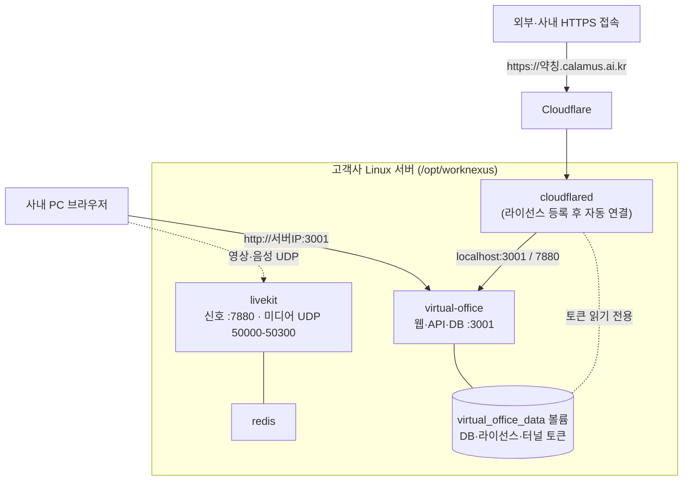

# Linux 서버 패키지 구성 · 설치 · 라이선스 발급 · 운영 가이드

> **문서 버전**: 2026-10-02 개정 (제품 1.0.4 기준, 우분투 시험 서버에서 실제 설치까지 검증)
> **대상 독자**: 고객사 리눅스 시스템 관리자·인프라 엔지니어, 공급사 기술지원팀
> **지원 환경**: Ubuntu 22.04/24.04 LTS 권장(그 밖의 64비트 Linux도 Docker Engine + Compose v2가 있으면 동작)
> **실제 구축 기록**: `mdfile/0. Linux_우분투서버_구축기록_2026-10-02.md` (문제와 해결 과정 포함)

---

## 📌 목차
1. [개요 및 구성](#1-개요-및-구성)
2. [배포 묶음 구성과 빌드 (공급사)](#2-배포-묶음-구성과-빌드-공급사)
3. [고객 서버 설치](#3-고객-서버-설치)
4. [최초 관리자 계정 만들기](#4-최초-관리자-계정-만들기)
5. [라이선스 요청·발급·등록](#5-라이선스-요청발급등록)
6. [외부 접속(고정 주소)과 사내 폐쇄망 운영](#6-외부-접속고정-주소과-사내-폐쇄망-운영)
7. [HTTPS — 마이크·카메라·화면공유를 쓰려면](#7-https--마이크카메라화면공유를-쓰려면)
8. [방화벽과 포트](#8-방화벽과-포트)
9. [업데이트·백업·복구](#9-업데이트백업복구)
10. [문제 해결 FAQ](#10-문제-해결-faq)
11. [방별 회의 예약 데이터 운영](#11-방별-회의-예약-데이터-운영-2026-09-28)

---

## 1. 개요 및 구성

Linux 판은 **Docker 컨테이너 4개**로 동작한다. Windows 판처럼 서버 PC에 프로그램을 직접 설치하지 않고, 공급사가 만든 이미지를 그대로 불러와 실행한다.

| 컨테이너 | 역할 | 포트 |
|---|---|---|
| `virtual-office` | 웹·API·WebSocket·SQLite(사원·채팅·근태·라이선스) | 3001 |
| `livekit` | 영상·음성·화면공유 중계(SFU) | 7880(신호), 7881/TCP, 50000-50300/UDP, 3478/UDP |
| `redis` | LiveKit 세션 동기화 | 내부 전용 |
| `cloudflared` | 고정 외부 주소(`약칭.calamus.ai.kr`) 터널 | 바깥으로만 연결(들어오는 포트 없음) |



**보안 규격**(모든 컨테이너): 파일시스템 읽기 전용(`read_only`), 권한 전부 제거(`cap_drop: ALL`), 권한 상승 차단(`no-new-privileges`), 비루트 사용자 실행.

**데이터 보존**: 사원·채팅·근태·라이선스·터널 토큰은 모두 도커 볼륨 `<프로젝트>_virtual_office_data`에 있다. 컨테이너를 다시 만들거나 버전을 올려도 그대로 남는다.

**라이선스 지문**: 서버의 `/etc/machine-id`를 읽기 전용으로 연결해 쓴다. 컨테이너를 다시 만들어도 같은 서버로 인식된다(시험 서버에서 확인).

---

## 2. 배포 묶음 구성과 빌드 (공급사)

### 2-1. 묶음 파일

파일 이름: `worknexus-server-linux-<버전>.tar.gz` (1.0.4 기준 약 142MB)

```text
worknexus-server-linux-1.0.4/
├── install.sh                  # 최초 설치
├── update.sh                   # 업데이트(백업·자동 복구 포함)
├── README.txt                  # 고객용 요약 안내
├── release-manifest.json       # 버전·이미지 목록
├── checksums.sha256            # 이미지 파일 확인 번호
├── docker-compose.yml          # 앱
├── docker-compose.media.yml    # LiveKit + Redis
├── docker-compose.tunnel.yml   # 고정 주소 터널(cloudflared)
├── deploy/
│   ├── docker.env.example      # 설정 예시(실제 값은 설치 때 자동 생성)
│   └── README.md
└── images/
    └── worknexus-images-1.0.4.tar.gz   # 앱·LiveKit·Redis·cloudflared 이미지(오프라인 설치용)
```

실제 값이 들어간 `deploy/docker.env`는 **절대 묶음에 넣지 않는다.** 설치 때 고객 서버에서 새로 만든다.

### 2-2. 빌드 방법

빌드는 Docker가 있는 Linux 머신에서 한다(현재 우분투 시험 서버 사용). Node는 없어도 된다.

```bash
# 1) 개발 노트북: 커밋된 소스를 LF 줄바꿈 그대로 묶는다
git -c core.autocrlf=false archive --format=tar.gz -o src.tar.gz HEAD
# 2) 빌드 서버로 복사해 풀고
mkdir -p ~/worknexus/build && tar -xzf src.tar.gz -C ~/worknexus/build && cd ~/worknexus/build
# 3) 빌드
bash scripts/package-linux.sh        # Node가 있으면: npm run package:linux
```

스크립트가 하는 일:
1. 버전 일치·Docker 구성을 검사한다.
2. 앱 이미지를 빌드한다.
3. LiveKit·Redis·cloudflared 이미지를 받는다. 태그는 compose 기본값을 쓴다.
4. 이미지를 `docker save`로 묶고, 텍스트 파일을 LF로 정리한다.
5. 최종 압축 파일과 SHA-256을 출력한다.

> ⚠️ 이 PC는 `core.autocrlf=true`라 그냥 `git archive`를 쓰면 CRLF로 바뀌어 빌드가 실패한다. 반드시 `-c core.autocrlf=false`로 만든다.

### 2-3. 공급자 포털에 올리기

1. 빌드 결과물을 노트북으로 가져온다.
2. 공급자 포털 → **릴리스** → 버전 입력 → 운영체제 **Linux 도커 묶음** → 파일 선택 → **R2에 업로드**한다. 파일은 50MB 조각으로 올라가며, 브라우저가 SHA-256을 계산한다.
3. **서명 후 게시**를 누른다. 같은 버전이 이미 게시돼 있으면 **새 파일 서명 후 재게시**를 누른다. 서명되지 않은 파일은 고객에게 보이지 않는다.
4. 같은 버전에 Windows 설치본도 올려 두 플랫폼을 맞춘다.

---

## 3. 고객 서버 설치

### 3-1. 준비물

- 64비트 Linux, **Docker Engine + Docker Compose v2**(`docker compose version`으로 확인)
- `/etc/machine-id` 파일(대부분 기본으로 있음)
- 권장 사양: 일반 거래처 동시 300명 기준 8코어·16GB·200GB SSD·1Gbps 유선, 강당·타운홀 거래처 12~16코어·32GB·300GB SSD(상세: `mdfile/3. 워크넥서스 사내망 HTTPS 구축 가이드 (고객 IT·보안팀용).md`)
- 포트 3001·7880·7881(TCP), 3478·50000-50300(UDP)를 다른 프로그램이 쓰지 않을 것

### 3-2. 묶음 받기 — 고객 다운로드 포털

1. 브라우저에서 `https://worknexus.calamus.ai.kr/download`를 연다.
2. 회사에서 등록한 이메일을 입력하고, 메일로 온 **일회용 번호(6자리)**를 입력한다. 비밀번호는 없다.
3. 버전 → **Linux 서버용 (Docker)** → **[서버에서 바로 받기]** → **[명령 복사]**를 누른다.
4. 서버 터미널에 붙여 넣는다. 링크는 1시간 동안, 최대 3번 쓸 수 있다.

```bash
curl -fL -o worknexus-server-linux-1.0.4.tar.gz 'https://worknexus.calamus.ai.kr/api/release-links/<토큰>'
echo '<SHA-256>  worknexus-server-linux-1.0.4.tar.gz' | sha256sum -c -
tar -xzf worknexus-server-linux-1.0.4.tar.gz
cd worknexus-server-linux-1.0.4 && sudo ./install.sh
```

인터넷이 안 되는 서버는 PC에서 **[내려받기]**로 받은 파일을 USB 등으로 옮긴 뒤 `tar -xzf` → `sudo ./install.sh`만 실행한다.

### 3-3. `install.sh`가 하는 일

| 단계 | 내용 |
|---|---|
| 1 | 관리자 권한, Docker·Compose, `/etc/machine-id` 확인 |
| 2 | 이미 설치돼 있으면 중단하고 `update.sh` 안내. 같은 프로젝트의 데이터 볼륨이 있으면 그대로 이어받는다 |
| 3 | 사내 IP 자동 감지, 포트 사용 여부 확인 |
| 4 | 이미지 확인 번호 검사 후 불러오기 |
| 5 | `/opt/worknexus`에 파일 복사, `deploy/docker.env` 생성(권한 600): 사내 IP, LiveKit 키·비밀값(무작위), 버전 |
| 6 | 서비스 시작 → `/health` 응답 확인 → 접속 주소와 **최초 관리자 등록 토큰** 출력 |

옵션: `--ip <사내IP>`(자동 감지가 틀릴 때), `--port <번호>`(3001 대신), `--no-tunnel`(폐쇄망), `--yes`(확인 질문 생략), `--dir`, `--project`.

### 3-4. 설치 후 관리 명령

```bash
sudo /opt/worknexus/compose.sh ps                 # 상태
sudo /opt/worknexus/compose.sh logs -f virtual-office   # 로그
sudo /opt/worknexus/compose.sh restart            # 재시작
```

> 설치 스크립트가 끝나기 전에 다른 터미널에서 `compose` 명령을 함께 실행하지 않는다. 시험 중 동시 실행으로 `removal of container … is already in progress` 오류가 한 번 났다.

---

## 4. 최초 관리자 계정 만들기

운영 판에는 기본 계정·비밀번호가 없다. 첫 실행 때 서버가 **일회용 등록 토큰**을 만든다.

1. `install.sh` 마지막에 출력된 토큰을 확인한다. 다시 보려면 다음 명령을 쓴다.
   ```bash
   sudo /opt/worknexus/compose.sh exec -T virtual-office cat /app/server/data/bootstrap-token.txt
   ```
2. 브라우저에서 `http://<서버IP>:3001` 접속 → 로그인 창의 **최초 관리자 등록**에 토큰, 아이디, 이메일, 이름, 비밀번호를 입력한다.
3. 등록하면 토큰은 자동으로 폐기된다.

---

## 5. 라이선스 요청·발급·등록

1. **요청 파일**: 관리자 콘솔 → **라이선스** 탭 → **요청 파일 다운로드**(`calamus-<설치ID>.calamus-request`)를 받아 공급사에 보낸다.
2. **발급(공급사)**: 공급자 포털 → **라이선스·서버**에서 계약을 고르고 요청 파일을 올린 뒤 **검증 후 라이선스 발급**을 누른다.
   - 발급 전에 고객사에 **고정 주소 약칭**이 있어야 한다. 고객 메뉴 → 고객사 목록 → "고정 주소" 칸 → **입력**에서 넣는다. 영문 소문자·숫자·하이픈 2~30자다.
   - 약칭이 없으면 `subdomain_slug_required` 대신 안내 문구가 나온다.
   - 발급하면 `약칭.calamus.ai.kr`, `약칭-media.calamus.ai.kr` 주소와 터널이 만들어지고, 약칭은 바꿀 수 없게 잠긴다.
3. **등록**: 관리자 콘솔 → 라이선스 탭 → **파일 선택**(`.calamus-license`) → **라이선스 등록**. 서버를 다시 시작할 필요는 없다.
4. **확인**: 관리자 콘솔의 상태가 `active`인지 본다. 또는 `curl -s http://127.0.0.1:3001/health`의 `license.status`를 확인한다.

**서버가 실제로 적용하는 라이선스 값은 두 가지뿐이다**:
- **동시접속 인원**(50/100/200/300, 외부 참석자(타운홀·방 회의) 포함)
- **타운홀 사용 여부**

방 정원(일반 30, 강당 100, 관리자가 조정)과 타운홀 200석은 제품 정책값이다. 라이선스 파일에 들어 있는 등록 사원 수·방당 인원 같은 옛 필드는 쓰지 않는다.

> 1.0.3 이하 서버에서는 다른 PC의 브라우저로 라이선스를 등록하면 `signature_invalid`가 날 수 있었다. 서버가 요청 본문의 한글을 깨뜨리던 문제로, **1.0.4에서 고쳤다**.

---

## 6. 외부 접속(고정 주소)과 사내 폐쇄망 운영

### 6-1. 고정 주소 (기본)

- `install.sh`는 기본으로 `docker-compose.tunnel.yml`을 포함한다.
- 라이선스를 등록하면 cloudflared가 데이터 볼륨의 토큰을 읽어 **1분 안에** `https://약칭.calamus.ai.kr`을 연다.
- 등록 전에는 토큰이 없어 재시도하며 기다린다. 이것은 정상이다.
- 확인: `curl -s http://127.0.0.1:3001/health`의 `tunnel.mode`가 `named`이고 `appUrl`이 고정 주소면 연결된 것이다.

### 6-2. 사내 폐쇄망 (외부 연결 없음)

Linux 판에서는 관리자 콘솔의 "외부 터널 차단" 버튼이 **터널 컨테이너를 멈추지 않는다.** 그 버튼은 Windows 판 서버가 직접 띄우는 터널 프로세스만 다룬다. 폐쇄망으로 쓰려면 다음과 같이 한다.

```bash
# 처음 설치할 때
sudo ./install.sh --no-tunnel

# 이미 설치한 서버에서 끄기
sudo sed -i 's/ -f docker-compose.tunnel.yml//' /opt/worknexus/compose.sh
sudo /opt/worknexus/compose.sh up -d --remove-orphans

# 다시 켜기
sudo sed -i 's/-f docker-compose.media.yml/-f docker-compose.media.yml -f docker-compose.tunnel.yml/' /opt/worknexus/compose.sh
sudo /opt/worknexus/compose.sh up -d
```

`update.sh`는 `compose.sh`의 선택을 그대로 따른다.

### 6-3. 사외에서 영상·음성 — 알려진 제약

- 고정 주소로 **화면·채팅·신호는 사외에서도 된다.**
- 영상·음성 데이터(UDP)는 LiveKit이 알려 주는 **서버 사내 IP**로 직접 가야 하므로, 사외 PC는 연결되지 않는다. Cloudflare 터널은 UDP 미디어를 실어 나르지 못한다.
- 사외 영상까지 필요하면 고객 공유기·방화벽에서 UDP 50000-50300, TCP 7881, UDP 3478을 서버로 포트포워딩하고, `LIVEKIT_USE_EXTERNAL_IP=true`로 설정해야 한다.
  - 내장 TURN의 중계 포트(기본 30000-40000)는 현재 열려 있지 않다.
  - 이 구성은 아직 검증하지 않았으므로, 필요한 거래처가 생기면 공급사와 함께 구성한다. 유료 클라우드 TURN은 쓰지 않는다.

---

## 7. HTTPS — 마이크·카메라·화면공유를 쓰려면

브라우저는 `http://사내IP:3001`에서 마이크·카메라·화면공유를 막는다. 로그인·3D·채팅은 된다. 방법은 둘 중 하나다.

1. **고정 주소 사용(권장, 추가 설정 없음)**: 사내에서도 `https://약칭.calamus.ai.kr`로 접속한다. 영상은 서버 사내 IP로 직접 가므로 사내망 속도는 그대로다.
2. **사내 인증서 + 리버스 프록시**: 외부 연결을 쓰지 않는 폐쇄망이면 사내 CA 인증서로 443을 연다. 앱은 `127.0.0.1:3001`, LiveKit 신호는 `127.0.0.1:7880`으로 프록시한다.

```nginx
server {
    listen 443 ssl http2;
    server_name vo.company.local;
    ssl_certificate     /etc/ssl/certs/company_vo_cert.pem;
    ssl_certificate_key /etc/ssl/certs/company_vo_key.pem;
    location / {
        proxy_pass http://127.0.0.1:3001;
        proxy_http_version 1.1;
        proxy_set_header Upgrade $http_upgrade;
        proxy_set_header Connection "upgrade";
        proxy_set_header Host $host;
        proxy_set_header X-Forwarded-For $proxy_add_x_forwarded_for;
        proxy_set_header X-Forwarded-Proto https;
    }
}
server {
    listen 443 ssl http2;
    server_name vo-rtc.company.local;
    ssl_certificate     /etc/ssl/certs/company_vo_cert.pem;
    ssl_certificate_key /etc/ssl/certs/company_vo_key.pem;
    location / {
        proxy_pass http://127.0.0.1:7880;
        proxy_http_version 1.1;
        proxy_set_header Upgrade $http_upgrade;
        proxy_set_header Connection "upgrade";
        proxy_set_header Host $host;
        proxy_set_header X-Forwarded-Proto https;
        proxy_read_timeout 3600s;
        proxy_buffering off;
    }
}
```

프록시를 쓰면 관리자 콘솔의 **사내 도메인** 설정에 앱 주소와 미디어 주소(`wss://vo-rtc.company.local`)를 등록하고, `deploy/docker.env`의 `CORS_ORIGINS`에도 추가한다. 자세한 내용은 `mdfile/3. 워크넥서스 사내망 HTTPS 구축 가이드 (고객 IT·보안팀용).md`를 참고한다.

---

## 8. 방화벽과 포트

| 포트 | 용도 | 누가 접속 |
|---|---|---|
| TCP 3001 | 웹·API·WebSocket | 사내 PC |
| TCP 7880 | LiveKit 신호 | 사내 PC |
| TCP 7881 | 미디어(UDP가 막힐 때) | 사내 PC |
| UDP 3478 | TURN | 사내 PC(사외 지원 시 외부) |
| UDP 50000-50300 | 영상·음성 | 사내 PC |
| (나가는 방향) 443, 7844 | cloudflared → Cloudflare | 서버에서 바깥으로 |

### ⚠️ Docker 포트는 ufw 규칙을 거치지 않는다 (시험 서버에서 확인)

- Docker는 공개 포트용 iptables 규칙을 직접 넣는다. 그래서 **ufw를 켜도 위 포트는 막히지 않는다.**
- 2026-10-02 시험 서버에서 ufw를 켜고 SSH·9090만 허용했는데도, 사내망에서 3001·7880이 그대로 응답했다.
- ufw는 SSH·관리 도구 등 **서버의 다른 서비스**를 지키는 용도로 쓴다.

```bash
sudo ufw allow OpenSSH
sudo ufw allow 9090/tcp        # Cockpit 등 쓰는 경우
sudo ufw enable
```

WorkNexus 포트 접근을 제한하려면 다음 방법 중 하나를 쓴다.
- **사내망 방화벽·공유기**에서 서버로 들어오는 대역을 제한한다(권장).
- `deploy/docker.env`의 `VO_BIND_ADDRESS`를 사내 IP로 지정해, 그 인터페이스에서만 웹을 연다.
- 고급: iptables `DOCKER-USER` 체인에 허용 대역 규칙을 넣는다(보안팀과 협의).

---

## 9. 업데이트·백업·복구

### 9-1. 업데이트 — `update.sh`

새 묶음을 3-2와 같은 방법으로 받아 풀고 실행한다.

```bash
cd worknexus-server-linux-<새버전> && sudo ./update.sh
```

1. 이미지 확인 번호를 검사하고 불러온다.
2. 앱을 잠시 멈추고, 데이터 볼륨 전체와 설정을 `/opt/worknexus/backups/<시각>-v<이전버전>/`에 백업한다.
3. 새 compose 파일을 복사하고, 새 설정 항목만 기본값으로 추가한다(기존 값 유지). 그다음 새 버전으로 시작한다.
4. `/health`가 응답하지 않으면 **이전 버전과 백업 데이터로 자동 복구**한다.

### 9-2. 수동 백업

```bash
B=/opt/worknexus/backups/manual-$(date +%Y%m%d-%H%M%S); sudo install -d -m 700 $B
sudo /opt/worknexus/compose.sh stop virtual-office
sudo docker run --rm --user 0 --entrypoint tar \
  -v worknexus_virtual_office_data:/data:ro -v $B:/backup \
  calamus/virtual-office:<현재버전> czf /backup/virtual_office_data.tar.gz -C /data .
sudo cp /opt/worknexus/deploy/docker.env $B/ && sudo chmod 600 $B/docker.env
sudo /opt/worknexus/compose.sh start virtual-office
```

### 9-3. 복구

```bash
sudo /opt/worknexus/compose.sh stop virtual-office
sudo docker run --rm --user 0 --entrypoint sh \
  -v worknexus_virtual_office_data:/data -v <백업폴더>:/backup:ro \
  calamus/virtual-office:<버전> -c 'find /data -mindepth 1 -delete && tar xzf /backup/virtual_office_data.tar.gz -C /data'
sudo /opt/worknexus/compose.sh up -d
```

---

## 10. 문제 해결 FAQ

**Q1. 라이선스 등록 시 `signature_invalid`**
- 1.0.3 이하에서 다른 PC로 큰 라이선스를 등록할 때 한글이 깨져 생겼다. 1.0.4로 업데이트한 뒤, **같은 파일**로 다시 등록하면 된다.
- 키 문제가 아니다. 리눅스용 라이선스 키는 따로 없다.

**Q2. 라이선스는 `active`인데 고정 주소가 열리지 않는다**
- `sudo /opt/worknexus/compose.sh ps`로 `cloudflared`가 실행 중인지 본다. 없으면 폐쇄망으로 설치된 것이다(6-2).
- `sudo /opt/worknexus/compose.sh logs --tail 30 cloudflared`에 `Registered tunnel connection`이 있는지 확인한다.

**Q3. 고객 다운로드 포털이 "계약을 찾지 못했습니다" 또는 "다운로드 권한이 등록되어 있지 않습니다"**
- 화면 위에 표시된 **로그인 이메일**을 확인한다.
- 같은 브라우저로 공급자 관리 화면에 로그인했으면 그 이메일로 자동 로그인된다. **다른 계정으로 로그인**을 누르고 고객 이메일로 다시 로그인한다.

**Q4. `sha256sum -c`가 실패한다**
- 내려받기가 중간에 끊긴 것이다. 포털에서 링크를 다시 만들어 받는다.

**Q5. `install.sh`가 "다른 프로그램이 포트를 쓰고 있습니다"로 멈춘다**
- 표시된 프로그램을 멈추거나, `--port`로 웹 포트를 바꾼다. 7880·7881은 바꿀 수 없다.

**Q6. 컨테이너 안에 파일을 넣을 수 없다(`docker cp` 거부)**
- 보안상 컨테이너가 읽기 전용이라 정상이다. 점검용 데이터는 `docker exec -i … < 파일`처럼 표준입력으로 넘긴다.

**Q7. VM의 CPU·메모리를 바꾸면 라이선스가 풀리나?**
- 아니다. 지문은 `/etc/machine-id` 등 시스템 식별자를 쓴다. OS를 새로 설치해 machine-id가 바뀌면 재발급이 필요하다.

**Q8. 화면공유가 연결 중에서 멈춘다**
- `http://` 주소로 접속했는지 확인한다(7장). 사내 방화벽이 UDP 50000-50300을 막는지 확인한다.

---

## 11. 방별 회의 예약 데이터 운영 (2026-09-28)

- 예약은 날짜가 포함된 `start_at`·`end_at`으로 저장되며 서버 시간이 아니라 브라우저가 보낸 절대 시각과 `timezone`을 함께 보존합니다.
- 기존 DB는 서버 시작 시 `meetings` 테이블에 호스트, 날짜, 상태, 템플릿 코드 컬럼과 일정 조회 인덱스를 자동 추가합니다. 마이그레이션 전에는 DB를 백업하십시오.
- 같은 방에서 시간이 겹치는 예약은 서버가 `meeting_room_time_conflict`로 거부합니다.
- 팀 전용 회의 입장은 예약자·관리자·해당 팀 사원에게만 허용됩니다.
- 생성·수정·삭제 이벤트는 WebSocket으로 접속자에게 즉시 전달됩니다. 프록시에서 WebSocket 업그레이드가 차단되면 새로고침 전까지 목록이 갱신되지 않습니다.
- 일반 방 회의는 외부 게스트를 허용하지 않습니다. 외부 초청 행사는 타운홀 세션과 게스트 코드를 사용하십시오.

검증 명령:

```bash
npm run test:meeting-schedule
npm run test:production-auth
```
