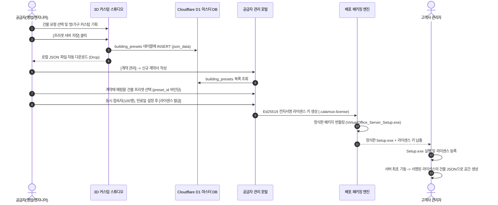

# 🏢 건물 & 방 커스텀 스튜디오 v2.3 프리셋 연동 및 계약 연계 종합 가이드

> **문서 버전**: v2.3.0
> **최종 갱신일**: 2026-09-24
> **대상**: 솔루션 기획자, 영업 대표, 엔터프라이즈 아키텍트, 풀스택 개발자  
> **핵심 키워드**: `방 커스텀 스튜디오`, `건물 템플릿 8종`, `Cloudflare D1 마스터 DB`, `JSON 프리셋`, `Ed25519 라이센스 연계`, `방(Room) 단위 시설 자동 생성`, `LiveKit SFU`

---

## 📌 목차
1. [스튜디오 개요 및 핵심 설계 사상](#1-스튜디오-개요-및-핵심-설계-사상)
2. [건물 템플릿 8종 체계 및 방 코드 자동 채번 규칙](#2-건물-템플릿-8종-체계-및-방-코드-자동-채번-규칙)
3. [프리셋 저장 및 불러오기 메커니즘 (3-Tier + Cloudflare D1)](#3-프리셋-저장-및-불러오기-메커니즘-3-tier--cloudflare-d1)
4. [JSON 데이터 규격 및 내보내기·불러오기 가이드](#4-json-데이터-규격-및-내보내기불러오기-가이드)
5. [고객 계약(Contract) 및 라이센스(License) 연계 프로세스](#5-고객-계약contract-및-라이센스license-연계-프로세스)
6. [스튜디오 실무 조작 매뉴얼 및 단축키·FAQ](#6-스튜디오-실무-조작-매뉴얼-및-단축키faq)
7. [방 단위 시설 자동 생성 및 미디어 엔진 연동 (2026-09-21~22 반영)](#7-방-단위-시설-자동-생성-및-미디어-엔진-연동-2026-09-21-22-반영)
8. [거래처별 템플릿 스코프 격리 완결 및 타운홀 설정 (2026-09-22 추가 반영)](#8-거래처별-템플릿-스코프-격리-완결-및-타운홀-설정-2026-09-22-추가-반영)

---

## 1. 스튜디오 개요 및 핵심 설계 사상

`방(Room) 템플릿 & 규격 가구 커스텀 스튜디오 v2.0`은 Virtual Office Enterprise의 핵심 공간 기획 도구입니다.

```
┌────────────────────────────────────────────────────────────────────────┐
│               🛠️ 방 & 규격 가구 커스텀 스튜디오 (v2.0)                    │
│                                                                        │
│   [1. 건물 유형 선택] ──> [2. 층 증축 & 방 구성] ──> [3. 36종 가구 2D 배치] │
│          │                                                  │          │
│          ▼                                                  ▼          │
│   [4. Cloudflare D1 영구 보관] <──── [5. 로컬 JSON 파일 떨구기/내보내기]  │
│          │                                                             │
│          ▼                                                             │
│   [6. 영업 계약 시 템플릿 선택] ──> [7. Ed25519 라이센스 발급] ──> [고객 배포] │
└────────────────────────────────────────────────────────────────────────┘
```

### 💡 핵심 설계 원칙
1. **층수 종속성 완전 탈피**: "2층 스타트업", "3층 학교"처럼 고정된 층수가 아닌, 고객의 사옥 규모에 맞춰 1층부터 N층까지 자유롭게 증축·확장할 수 있습니다.
2. **저장 영역을 명확히 분리**: 고객 설치 서버의 저장은 고객 SQLite/로컬 JSON에, 공급자 마스터 프리셋은 Access로 보호된 공급자 포털 D1에 저장합니다. 공개 try는 데모 전용 저장 경로를 사용합니다. 고객 설치본이 공급자 D1에 자동으로 쓰지는 않습니다.
3. **영업-계약-배포 일체형 파이프라인**: 기획자가 스튜디오에서 완성한 공간 프리셋을 저장하면, 공급자 관리 포털에서 계약서 작성 시 해당 프리셋을 선택하여 고객사 전용 라이센스로 즉시 출하합니다.

---

## 2. 건물 템플릿 8종 체계 및 방 코드 자동 채번 규칙

### 2.1 업종별 8대 도메인 건물 템플릿

| 템플릿 코드 (`templateCode`) | 건물 템플릿 명칭 | 추천 업종 및 공간 특징 | 방 코드 접두어 |
| :--- | :--- | :--- | :---: |
| `startup` | **스타트업** | 오픈 데스크, 애자일 스크럼룸, 타운홀, 루프탑 테라스 | `STU` |
| `company-standard` | **일반회사·중소기업** | 사업본부별 업무실, 대형 컨퍼런스 회의실, CEO 임원 집무실 | `COM` |
| `rnd-center` | **연구소·R&D 센터** | AI/데이터 분석랩, 보안 하드웨어 연구실, 프로젝트 룸 | `RND` |
| `finance-global` | **금융·글로벌** | 글로벌 딜링룸, VIP 프라이빗 상담실, 감사/컴플라이언스실 | `FIN` |
| `public-agency` | **공공기관·지자체** | 종합 민원 대면 상담실, 행정 대회의실, 기록물 보관실 | `PUB` |
| `school` | **학교·교육기관** | 1~3학년 정규 교실(24석 규격), 교무실, 시청각 대강당 | `SCH` |
| `custom-rooftop` | **맞춤 사옥 + 옥상정원** | 도심 뷰 프리미엄 사옥, 힐링 젠가든, 스카이 라운지 | `ROOF` |
| `custom` | **자유 맞춤설계** | 백지 상태에서 층수/방수/소품을 100% 자율 구성하는 공간 | `CUST` |

### 2.2 방 코드 자동 채번(Increment) 규칙
방을 추가할 때 기존 방 코드가 중복 복제되지 않고 아래 규칙에 따라 시퀀스가 자동으로 증가합니다.

- **기본 포맷**: `RM-{템플릿접두어}-{층수}{시퀀스2자리}`
  - 예: 스타트업 1층 첫 번째 방 ➔ `RM-STU-101`
  - 예: 스타트업 1층 두 번째 방 ➔ `RM-STU-102`
  - 예: 스타트업 3층 첫 번째 방 ➔ `RM-STU-301`
  - 예: 학교 2층 세 번째 방 ➔ `RM-SCH-203`
- **중복 방지 및 원클릭 복구**:
  - 외부 JSON 불러오기 등으로 인해 코드가 겹치면 상단에 `[⚠️ 코드 자동정리]` 버튼이 활성화되며, 클릭 시 층별로 101, 102, 201 순으로 일괄 재정렬됩니다.

---

## 3. 프리셋 저장 및 불러오기 메커니즘 (3-Tier + Cloudflare D1)

스튜디오에서 **[☁️ 프리셋 서버 저장]**을 눌렀을 때의 저장 위치는 실행 환경과 권한에 따라 다릅니다. 모든 환경이 네 계층에 동시에 쓰는 구조가 아닙니다.

```
[사용자 브라우저] (스튜디오 작업)
       │
       ├─① [로컬 브라우저 캐시] ──> localStorage['vo_saved_building_presets']
       ├─② [브라우저 자동 다운로드] ──> 사용자 PC Downloads/{이름}_{timestamp}.json (Drop)
       │
       ├─③ (로컬 서버 구동 시) ──> public/building_presets/*.json & SQLite virtual_office.db
       │
       └─④ [공급자 권한 환경만] ──> Cloudflare D1: 공급자 마스터 프리셋
```

### 3.1 저장 계층 상세

1. **로컬 브라우저 (`localStorage`)**:
   - 편집 도중 새로고침이나 탭 종료가 일어나도 작업 내용이 유실되지 않도록 브라우저에 임시 캐싱.
2. **로컬 파일시스템 ([public/building_presets/](../public/building_presets/))**:
   - 로컬 서버 구동 환경에서 영구 파일로 기록되어 Git 형상 관리 및 서버 재시작 시에도 유지.
   - 브라우저에서는 사용자 다운로드 폴더로 `.json` 파일이 즉시 자동 떨궈짐(Drop).
3. **로컬 SQLite DB (`server/data/virtual_office.db`)**:
   - 로컬 온프레미스 서버의 `building_presets` 테이블에 메타데이터 및 원본 JSON 저장.
4. **Cloudflare D1 마스터 DB**:
   - **라이센스 발급의 단일 진실 공급원(Single Source of Truth)**.
   - Cloudflare Access 인증을 통과한 공급자 포털이 마스터 프리셋을 저장하는 영역입니다.
   - 고객 설치 서버의 무인 Auto-sync와 브라우저의 공급자 API 직접 폴백은 제거되었습니다. 공급자 D1 변경은 공급자 포털을 통해서만 수행합니다.
   - 공개 try 스튜디오는 `DEMO_DB`가 있는 같은 출처의 데모 경로를 사용하며, 고객 운영 데이터와 분리됩니다.

### 3.2 프리셋 보관함에서 불러오기
- 스튜디오 상단 **[📂 프리셋 보관함]** 버튼 클릭:
  - D1 DB 및 로컬에 보관된 프리셋 목록을 최신순으로 정렬하여 표시.
  - **[📥 스튜디오에 불러오기]**: 해당 건물의 층/방/가구 레이아웃을 캔버스로 즉시 로드.
  - **[🌐 3D 월드로 즉시 입장]**: 별도 저장 과정 없이 해당 공간을 3D 가상세계로 즉시 반영하고 아바타로 입장.

---

## 4. JSON 데이터 규격 및 내보내기·불러오기 가이드

### 4.1 JSON 프리셋 데이터 스펙

```json
{
  "timestamp": "2026-09-18T02:30:00.000Z",
  "buildingTemplateCode": "startup-2f",
  "buildingName": "스타트업",
  "roomTemplates": [
    {
      "id": "rm-stu-101",
      "buildingTemplateCode": "startup-2f",
      "category": "work",
      "roomCode": "RM-STU-101",
      "name": "1F 애자일 스크럼 개발실",
      "floor": 1,
      "capacity": 24,
      "dimensions": { "width": 24, "depth": 20 },
      "screenSlot": 1,
      "placedItems": [
        {
          "id": "item-desk-1",
          "catalogId": "desk_cluster_4p",
          "x": -4.5,
          "z": 2.0,
          "rotation": 90,
          "label": "개발 1팀 4인 파티션 데스크"
        },
        {
          "id": "item-screen-1",
          "catalogId": "large_display_screen",
          "x": 0,
          "z": -9.2,
          "rotation": 0,
          "label": "전면 대형 공유 스크린"
        }
      ]
    }
  ]
}
```

### 4.2 필드 명세

| 필드 | 타입 | 설명 |
| :--- | :---: | :--- |
| `timestamp` | String(ISO) | 생성/저장 일시 |
| `buildingTemplateCode` | String | 8대 건물 템플릿 코드 (`startup-2f`, `school` 등) |
| `buildingName` | String | 템플릿 표시 명칭 |
| `roomTemplates` | Array | 건물에 소속된 방 목록 |
| `roomTemplates[].roomCode` | String | 고유 방 코드 (`RM-STU-101`) |
| `roomTemplates[].floor` | Number | 위치 층수 (1~N층) |
| `roomTemplates[].capacity` | Number | 수용 인원 (좌석 수) |
| `roomTemplates[].placedItems` | Array | 방 내부에 배치된 36종 규격 가구 및 소품 목록 |
| `placedItems[].catalogId` | String | 가구 규격 카탈로그 ID (`desk_standard`, `stage_platform` 등) |
| `placedItems[].x`, `z` | Number | 방 중심(0,0) 기준 상대 좌표 (단위: 미터) |
| `placedItems[].rotation` | Number | 소품 회전 각도 (`0`, `90`, `180`, `270`) |

### 4.3 [JSON 내보내기] 및 [JSON 불러오기]
- **[JSON 내보내기]**:
  - 버튼 클릭 시 `${건물명}_${Date.now()}.json` 파일이 브라우저에서 자동 다운로드됩니다.
  - 동시에 클립보드에 포맷팅된 JSON 문자열이 복사되어 계약서 첨부나 이메일 전송에 즉시 활용 가능합니다.
- **[JSON 불러오기]**:
  - 외부에서 전달받은 JSON 파일의 텍스트 내용을 붙여넣으면 유효성을 즉시 검증한 후 스튜디오에 일괄 적용합니다.

---

## 5. 고객 계약(Contract) 및 라이센스(License) 연계 프로세스

공급자가 고객사와 영업 상담 후 계약을 체결하고 라이센스를 발급하는 전체 흐름입니다.



### 5.1 계약 등록 및 프리셋 매핑 (`SupplierManagePortal.tsx`)
1. 공급자 포털의 `계약 관리(contracts)` 메뉴에서 [신규 계약 등록]을 오픈합니다.
2. 고객사명, 담당자, 계약 기간(예: 1년), 라이센스 티어(Enterprise), 최대 수용 인원을 입력합니다.
3. **[공간 프리셋 선택]** 드롭다운에서 `calamus-virtual-office` D1 DB에 저장된 프리셋(예: `일반회사·중소기업 5F 맞춤세팅`)을 선택합니다.
4. 계약 레코드에 `preset_id`와 프리셋의 해시값이 영구 연결됩니다.

### 5.2 Ed25519 암호화 라이센스 발급
- 공급자 발급 키(`LICENSE_PRIVATE_KEY`)로 다음 페이로드를 전자서명합니다.
  ```json
  {
    "licenseId": "LIC-202609-001",
    "customerCode": "CUST-SAMSUNG-01",
    "tier": "enterprise",
    "maxUsers": 100,
    "allowedFloors": 5,
    "buildingPresetId": "일반회사_중소기업_5F_맞춤세팅_1789664465995",
    "expiresAt": 1820419200000
  }
  ```
- 고객사 온프레미스 서버는 패키지에 포함된 공개 검증키(`server/license-public.pem`)로 서명을 검증하며, 위조나 변조가 원천 차단됩니다.

### 5.3 고객사 최초 부팅 시 자동 프로비저닝
- 고객사 서버가 처음 실행될 때:
  1. 등록된 라이선스에 서명되어 들어있는 건물 프로필과 `customFloors[].rooms[]`를 확인합니다.
  2. 고객 운영 서버는 공급자 D1에 의존하지 않고 서명된 건물 JSON과 패키지 정적 자산으로 공간을 구성합니다.
  3. 사내 SQLite DB(`server/data/virtual_office.db`)의 `room_templates`와 `building_presets` 테이블에 즉시 삽입합니다.
  4. **여기서 끝나지 않습니다** — 서버가 이 방 목록을 직접 분석해서 방마다 부서(팀), 화상회의 스크린, 화이트보드 마스터 레코드와 사람이 읽는 직렬 코드(`RM-{템플릿코드}-{층}{순번}`)까지 자동으로 함께 만들어 둡니다(7장 참고). 스튜디오에서 손으로 하나하나 배정할 필요가 없습니다.
  5. 고객사 사원들이 브라우저로 접속하는 즉시 영업 때 시연했던 3D 가상공간이 그대로 펼쳐지며, 회의실도 이미 방마다 활성화된 상태입니다.

---

## 6. 스튜디오 실무 조작 매뉴얼 및 단축키·FAQ

### 6.1 캔버스 및 소품 조작 단축키

| 조작 행위 | 조작 방법 | 설명 |
| :--- | :--- | :--- |
| **소품 선택** | 캔버스 소품 마우스 좌클릭 | 선택 시 하늘색 테두리 및 회전/삭제 툴바 표시 |
| **소품 이동** | 클릭한 채 드래그 | 0.5m 단위 그리드 스냅으로 반듯하게 정렬 |
| **90도 회전** | 키보드 <kbd>R</kbd> 키 | 0° ➔ 90° ➔ 180° ➔ 270° 순환 회전 (벽에 붙인 벽걸이 소품은 방 안쪽 방향으로 고정 — 9.8 참고) |
| **소품 삭제** | 키보드 <kbd>Del</kbd> 또는 <kbd>Backspace</kbd> | 선택된 소품 즉시 제거 |
| **소품 복제** | 하단 툴바 <kbd>복제</kbd> 버튼 | 동일한 각도와 사양의 소품을 바로 옆에 복제 생성 |
| **책상 자동배치**| 수용 정원 변경 시 자동 적용 | 10인/24인/50인 정원에 맞춰 최적 황금 그리드로 자동 정렬 |
| **인테리어 일괄 복제** | 좌측 방 목록 [인테리어 복제] 버튼 | 완성된 방 가구 구성을 다른 모든 방에 원클릭 일괄 복사 |
| **AI 공간 자동 기획** | 상단 [🪄 AI 공간 자동 기획] | 해커톤룸, 대강당, 도서관, 임원실 등 1초 완성 테마 적용 |

### 6.2 자주 묻는 질문 (FAQ)

**Q1. 로컬 PC에서 작업한 프리셋이 클라우드 배포본(`try...`)에서도 보이나요?**  
**A1.** 자동으로 보이지 않습니다. 고객 로컬 저장과 공급자 D1은 보안상 분리되어 있습니다. 로컬에서 완성한 JSON을 내보내 공급자에게 전달하고, 공급자 포털에서 고객 전용 프리셋으로 저장·계약 연결해야 합니다.

**Q2. 인터넷이 연결되지 않은 폐쇄망 서버에서는 프리셋이 어떻게 동작하나요?**  
**A2.** 패키지에는 기본 프리셋과 정적 자산이 함께 들어 있으므로 계약에 포함된 건물은 공급자 D1에 실시간 접속하지 않고도 동작합니다. 다만 외부 화상회의/화면공유는 별도의 네트워크 경로가 필요하고, 설치형 Demo의 선택 화면에는 현재 시험 가능한 4개 건물셋만 노출됩니다.

**Q3. 3층까지만 만들었는데 가상공간에 4층, 5층이 보일 때는 어떻게 하나요?**  
**A3.** v2.0에서는 방 목록의 `max(floor)`와 템플릿의 `totalFloors`가 실시간 연동되어 해결되었습니다. 스튜디오에서 [3D 오피스 실시간 동기화] 버튼을 한 번 클릭하면 3D 월드에 실제 등록된 층과 방이 반영됩니다. 사용자는 화면 상단의 층 선택 버튼과 방 선택 메뉴에서 목적지를 골라 이동합니다.

**Q4. 방마다 화면 공유를 P2P로 할지 LiveKit SFU로 할지 스튜디오에서 골라야 하나요?** (2026-09-26 현행화: 화면공유뿐 아니라 회의 음성·카메라, 1:1 화면공유·통화, 방 안 근처 대화·머리 위 카메라까지 모든 미디어가 LiveKit SFU로만 흐르며 P2P는 없습니다. 방 안 근처 대화의 방별 허용 여부는 스튜디오가 아니라 고객 관리자 콘솔 "방별 시설 관리"에서 정합니다.)  
**A4.** 아니요, 고를 필요가 없습니다. 회의실 화면공유는 방 크기와 무관하게 **항상 내장 LiveKit SFU 미디어 서버**를 거칩니다. `screenSlot` 필드는 "이 방에 화면공유를 켤지 말지"만 결정하며, 시청 정원은 방의 `capacity`를 따릅니다. 2026-09-26부터 1:1 개인 화면공유·1:1 통화·회의 마이크/카메라·근처 대화·머리 위 카메라도 모두 LiveKit을 사용하며 사용자 간 P2P 미디어 경로는 없습니다. 자세한 전송 구조는 `2. LiveKit_SFU_연동_구현및운영가이드_2026-09-24.md` 4장을 참고합니다.

---

## 7. 방 단위 시설 자동 생성 및 미디어 엔진 연동 (2026-09-21~22 반영)

스튜디오에서 만든 방 프리셋이 고객 서버에 적용된 뒤, 실제로 무슨 일이 일어나는지를 다룹니다 — 5.3절의 "자동 프로비저닝"을 더 자세히 설명하는 절입니다.

### 7.1 서버가 방 목록만 보고 자동으로 만드는 것들
고객 서버가 기동되면(또는 관리자가 [관리자 콘솔] → [팀] → "건물 방 구조로 부서 자동 생성"을 누르면), 서버는 활성화된 라이센스/프리셋의 방 목록을 직접 읽어 다음을 자동 생성합니다(`resolveRoomsForTemplate()` + `generateFacilitiesForTemplate()`):

- **방마다 부서(팀) 자동 생성**: 스튜디오에서 방을 만들 때 팀을 미리 지정해 둘 필요가 없습니다. 방이 있으면 그 방을 쓰는 부서가 자동으로 만들어집니다.
- **화상회의 스크린 / 화이트보드 마스터 레코드**: 방 JSON에 `screenSlot`이나 `whiteboard: true`가 있으면 해당 시설이 자동으로 활성화됩니다.
- **사람이 읽는 직렬 방 코드**: 스튜디오에서 `roomCode`를 직접 지정하지 않았어도, 서버가 `RM-{템플릿코드}-{층}{순번}`(예: `RM-STU-101`) 형태로 자동 채번합니다. 같은 작업을 다시 실행해도 이미 배정된 코드는 그대로 유지됩니다.
- 이 작업은 몇 번을 다시 실행해도 기존 배치를 덮어쓰지 않고 갱신만 합니다 — 안전하게 반복 실행 가능합니다.

### 7.2 생성된 이후에는 관리자 콘솔에서 방별로 개별 관리
자동 생성이 끝난 뒤에도 [관리자 콘솔] → [팀] 탭 하단의 "방별 시설 관리" 패널에서 방마다 화상회의 스크린·화이트보드 사용 여부를 개별로 켜고 끌 수 있습니다. 스튜디오에서 처음에 빠뜨린 시설도 여기서 나중에 추가할 수 있습니다.

### 7.3 화면공유는 방 크기와 무관하게 항상 LiveKit SFU
과거에는 방마다 "P2P 직결(최대 6인)" 또는 "LiveKit SFU(대규모)"를 스튜디오에서 선택해야 했습니다. 2026-09-22부로 이 선택 자체가 사라졌으며, **회의실 화면공유는 예외 없이 항상 LiveKit SFU를 씁니다.** 2026-09-26부터는 1:1 개인 화면공유와 음성·영상 통화도 두 사용자 전용 LiveKit 방을 사용합니다. 관리자는 전송 방식을 선택할 필요 없이 방 정원(`capacity`)과 화면공유 시설(`screenSlot`) 사용 여부만 관리하면 됩니다.

---

## 8. 거래처별 템플릿 스코프 격리 완결 및 타운홀 설정 (2026-09-22 추가 반영)

### 8.1 거래처별 템플릿 편집이 공용 샘플을 오염시키던 문제

[5단계](../mdfile/Context.md)에서 실제 영구 데이터(`roomTemplates` 배열, DB의 `building_presets`)는 `ownerScope`/`customer_code`로 이미 올바르게 분리돼 있었지만, **3D 미리보기에 쓰는 전역 캐시 객체 `DEMO_BUILDING_PLANS[템플릿코드]`**(스튜디오를 보는 모든 사람이 공유)는 스코프 구분 없이 계속 덮어써지고 있었습니다. 그래서 거래처(예: 유진IT) 전용 건물셋을 편집·저장하면 같은 업종의 공용 샘플 탭(예: "스타트업")에도 그 거래처의 방 구성이 그대로 보이는 문제가 있었습니다. 두 지점을 고쳤습니다:

- **"기본셋 저장" 시**(`saveCategoryAsDefaultDemoSet()`): `DEMO_BUILDING_PLANS[category].floors`와 `localStorage`의 `vo_custom_demo_default_{category}` 키(앱 시작 시 그대로 로드되는 캐시)를 이제 `customerCode === 'COMMON'`으로 저장할 때만 갱신합니다.
- **거래처 모드를 나갈 때**("✕ 거래처 모드 종료", `exitCustomerTemplateMode()`): 이전엔 스코프 플래그만 껐지, 거래처 편집 중 미리보기에 반영해 뒀던 캐시를 공용 최종본으로 되돌리는 로직이 없었습니다. 이제 공용 모드로 돌아올 때 그 업종의 COMMON 활성 버전을 서버에서 다시 불러옵니다.

> ⚠️ 이 버그로 인해 수정 전 세션에서 이미 브라우저 `localStorage`가 오염됐다면, 수정 이후에도 새로고침 시 예전 값이 다시 로드될 수 있습니다. 여전히 공용 탭에 거래처 방이 보이면 개발자 콘솔에서 `localStorage.removeItem('vo_custom_demo_default_{템플릿코드}')` 실행 후 새로고침하세요.

### 8.2 거래처 모드 UI 변경

- **"빈 방으로 시작하기" 옵션**: "거래처별 템플릿 편집" 모달에 체크박스를 추가했습니다. 로컬 개발 DB처럼 거래처 전용본도 공용 COMMON 최종본도 없는 환경에서, 선택한 업종의 방 코드 규칙만 가져오고 방은 없이 시작할 수 있습니다("+ 새 방 추가"로 바로 만들기). 이미 저장된 전용 건물셋이 있는 상태에서 체크하면 확인창으로 한 번 더 물어봅니다(저장하기 전까지 기존 저장본에는 영향 없음).
- **탭 강조 방식 변경**: 거래처 모드 중에는 상단의 원본 업종 탭(예: "스타트업")을 더 이상 함께 강조하지 않습니다. 상단 탭에서 언제든 다른 기본 템플릿을 다시 불러오거나 다른 거래처로 바꿀 수 있는 구조라, 업종 탭까지 같이 켜져 있으면 "지금 이 업종도 같이 편집 중"으로 오해하기 쉽다는 피드백을 반영했습니다. 지금 편집 중인 건 오직 "거래처별 템플릿" 버튼 하나로만 표시됩니다.

### 8.3 스튜디오의 "🏛️ 타운홀 설정" 버튼과 관리자 콘솔의 역할 분담

헤더의 "🏛️ 타운홀 설정" 버튼은 지금 편집 중인 건물 템플릿(또는 거래처 전용 스코프)별로 **사용여부**와 **게스트 등록 기본값**만 다룹니다(`PUT /api/townhall/settings`, `server/db.js`의 `building_config` 테이블에 `townhall_settings:{템플릿코드}`로 저장). 회사명·로고는 여기서 다루지 않습니다 — 스튜디오는 개발자 전용 도구라 실제 고객 운영 단계에서는 접근할 수 없으므로, 회사명·로고는 **설치 후 관리자 콘솔의 "라이선스" 탭**("🏛️ 타운홀 브랜딩" 섹션)에서 고객 관리자가 직접 설정합니다(비워두면 라이선스의 계약사명이 그대로 표시됨). 운영 환경에서는 사용여부가 라이선스의 `townHallEnabled` 필드와 결합돼, 스튜디오/관리자 콘솔의 로컬 설정이 라이선스가 허용한 범위를 넘어 켤 수는 없습니다.

---

## 9. 2026-09-24 저장·권한·계약 연계 현행 기준

### 9.1 어느 저장 버튼이 어디에 저장하는가

| 실행 위치 | 저장 대상 | 공급자 계약에서 바로 선택 가능? |
|---|---|---|
| 고객 설치 서버 | 고객 SQLite 및 로컬 JSON | 아니요. JSON 전달 후 공급자 포털에 게시해야 함 |
| 공개 try | 데모 DB 및 브라우저 백업 | 아니요. 공개 시연 데이터로 취급 |
| 공급자 통합관리포털 | 공급자 D1의 공용/고객 전용 프리셋 | 예. 활성 계약의 건물 프로필로 선택 가능 |

쓰기 작업은 서버 권한으로 다시 검사합니다. 프리셋 저장·삭제·기본셋 지정·초기화는 개발자 세션 또는 `building.manage` 권한이 필요하며, 화면에서 버튼을 숨기는 것만으로 보안을 대신하지 않습니다. 로그아웃 후 이전 세션으로 저장을 계속할 수도 없습니다.

### 9.2 고객 전용 프리셋이 공용 샘플을 오염시키지 않는 규칙

- `COMMON`은 공용 샘플 전용 범위입니다.
- 고객 코드를 가진 편집 세션은 해당 고객 범위에만 새 버전을 만듭니다.
- 고객 전용 저장 때 전역 캐시/localStorage의 공용 기본셋을 덮어쓰지 않습니다.
- 고객 모드에서 나와 공용 모드로 돌아오면 서버의 최신 `COMMON` 활성 버전을 다시 읽습니다.
- 화면 상단의 현재 편집 버전 표기로 어느 버전을 수정 중인지 확인한 뒤 저장합니다.

### 9.3 직접 수정한 건물을 실제 고객 라이선스에 넣는 정확한 순서

1. 스튜디오에서 층, 방, 정원, 화면 스크린, 화이트보드와 가구를 편집합니다.
2. JSON을 내보내 별도 백업합니다.
3. 공급자 포털에서 해당 고객 전용 프리셋으로 저장하고 활성 버전을 확인합니다.
4. 계약 화면에서 이 프리셋을 선택해 계약 건물 프로필을 확정·활성화합니다.
5. 고객 서버에서 새 `.calamus-request`를 생성해 공급자에게 전달합니다.
6. 공급자는 그 요청과 활성 계약을 이용해 `.calamus-license`를 발급합니다.
7. 고객 서버가 라이선스를 등록하고 재시작하면 서명된 건물 구성이 적용됩니다.

> [!IMPORTANT]
> 인증요청파일은 건물 파일이 아닙니다. 요청 파일에는 서버 인스턴스 공개키와 식별 정보가 들어가며, 건물은 공급자 포털의 계약 건물 프로필에서 선택되어 라이선스에 서명됩니다.

### 9.4 재설치와 인증요청파일

| 상황 | 인증요청파일 재생성 |
|---|---|
| 같은 설치 폴더에 프로그램만 덮어쓰기, `server/data` 보존 | 보통 불필요 |
| 새 서버 PC로 이동 | 필요 |
| 완전 삭제 후 새로 설치 | 필요 |
| `server/data/license-instance.json` 유실/교체 | 필요 |

재설치 전에는 최소한 `server/data`와 직접 내보낸 건물 JSON을 백업합니다. 새 인스턴스 요청을 발급할 때에도 9.3절의 계약 건물 프로필이 올바른지 먼저 확인해야 합니다.

### 9.5 오늘 반영된 스튜디오 표현·가구 개선

- 저장/배포 버튼 동선을 정리하고 현재 편집 버전을 화면에 표시했습니다.
- 1인 안락의자의 좌석·등받이·팔걸이·다리 렌더링을 바로잡았습니다.
- 회의실 배치용 긴 테이블(`table_meeting_long`)과 회의용 의자(`chair_meeting_room`)를 추가·개선했습니다.
- 고객 전용 저장 후 공용 기본 프리셋 캐시가 바뀌는 문제를 차단했습니다.
- try 스튜디오의 정상 저장이 Cloudflare Access 미들웨어에 막히던 경로는 데모 DB가 바인딩된 같은 출처 요청에 한해 수정했습니다. 공급자 포털의 Access 보호는 유지됩니다.

### 9.6 화면공유 수 산정

계약의 화면공유 상한을 임의의 고정 5건으로 제한하지 않습니다. 활성 라이선스의 건물 프로필에서 화면공유가 허용된 실제 방/스크린 수가 최대 동시 송출 수입니다. 서버는 같은 방의 발표자 1명, 같은 사용자의 중복 송출 금지, 방별 LiveKit 채널 분리를 함께 검사합니다.

### 9.7 남은 개발 항목

- 고객 한 곳에서 병원·지점별 여러 건물을 선택·배포하는 전체 UI와 서버 모델
- 스튜디오 저장 실패 시 성공 토스트가 남지 않도록 모든 경로의 응답 검사를 일관되게 정리
- 가구 카탈로그 전체의 충돌/보행 경로 및 모바일 편집 사용성 검증
- 계약 변경·갱신 시 기존 방 데이터와 새 건물 프로필의 마이그레이션 정책

### 9.9 팀·전사 일정 보드 (`schedule_board`, 2026-10-12)

- 이번 주 일정(행사·휴가·마감 등 + 회의·타운홀)을 벽에 보여 주는 소품입니다. 클릭·E 키로 달력을 엽니다.
- **팀이 배정된 방**에 걸면 그 팀 + 전사 일정, **팀이 없는 방**(로비·라운지 등)에 걸면 전사 일정을 보여 줍니다. 그래서 팀 사무실과 로비에 하나씩 거는 것을 권장합니다.
- 공유 스크린 바로 옆(약 4m 안)에 걸면 다가갔을 때 스크린의 E 키 안내가 우선합니다. 스크린과 떨어진 벽에 겁니다.
- 벽걸이 소품이라 9.8의 자동 방향 규칙이 적용됩니다.

### 9.8 벽걸이 소품 자동 방향 (2026-10-09, 1.0.7)

평면도에서 소품은 네모로만 보여 앞면이 방 쪽인지 벽 쪽인지 구분되지 않았고, 그래서 화이트보드가 벽을 보고(3D에서 뒷면이 보이게) 붙는 경우가 있었습니다.

- **대상**: 화이트보드(`whiteboard_3d`), 디지털 사내 게시판·아카이브(`gallery_archive_board`), 팀·전사 일정 보드(`schedule_board`, 2026-10-12 추가), 공유 스크린(`screen_display*`).
- **규칙**: 벽에서 **4m 안**이면 가장 가까운 벽을 기준으로 앞면이 방 안쪽을 봅니다. 뒷벽 0°, 출입문 벽 180°, 왼쪽 벽 90°, 오른쪽 벽 270°. 방 가운데(28×24 방이면 좌우 ±10m, 앞뒤 ±8m 안쪽)에 둔 것은 지정한 각도를 그대로 씁니다.
- **스튜디오**: 벽 근처에 내려놓으면 자동으로 돌아가고 "벽에 붙인 소품 N개를 방 안쪽을 보도록 자동 회전했습니다" 안내가 뜹니다. 벽 근처에서는 R(회전)을 눌러도 이 방향을 유지합니다. 벽걸이 소품은 **앞면 쪽 가장자리에 금색 선**이 표시됩니다.
- **3D 오피스**: 예전에 저장된 건물도 다시 편집하지 않아도 같은 규칙으로 보정해서 그립니다. 저장값(JSON)은 스튜디오에서 다시 옮기거나 저장할 때 바뀝니다.
- 공통 규칙 코드: `src/utils/wallMount.ts`. 기본 프리셋 중 화이트보드가 벽을 보던 4곳(전면 교실·대회의실·강당·타운홀)의 값도 0°로 고쳤습니다.

---

*현행화: 2026-09-24 · 변경 이력은 `mdfile/CHANGELOG_01.md` 참고*
