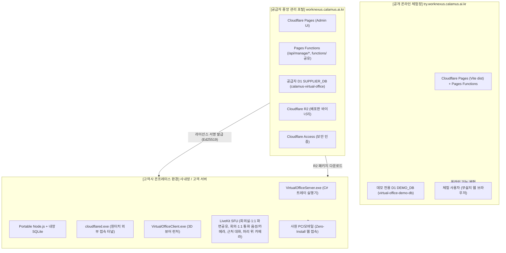
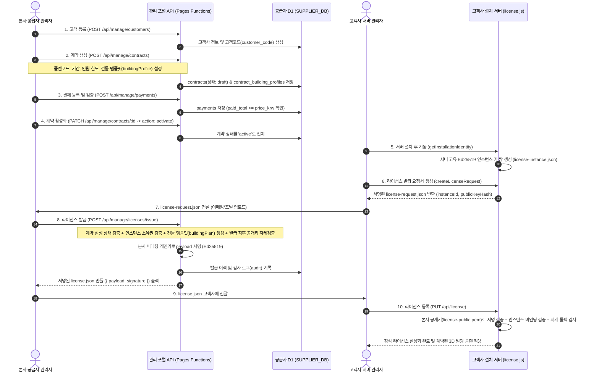
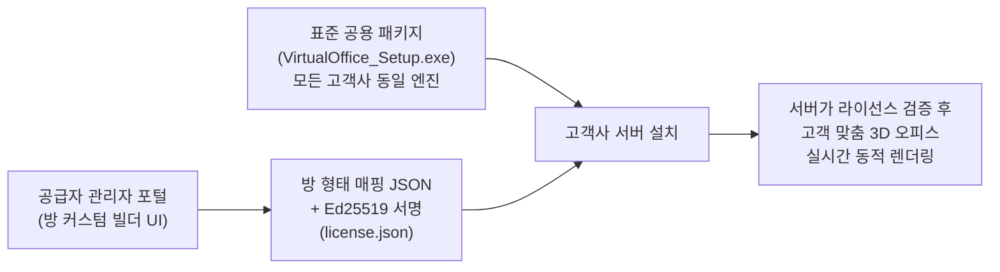

# Cloudflare 통합관리포털 · 배포 및 운영 가이드 (2026-09-24)

최종 현행화: 2026-10-02 (릴리스 멀티파트 업로드·플랫폼별 파일, 릴리스 서명 키, 고객 다운로드 Access, 고정 주소 약칭 UI — 15장)

> [!IMPORTANT]
> 2026-09-23 절의 초기 터널 설계 중 **서명되지 않은 `bundle.tunnel`과 운영 Quick Tunnel 폴백 설명은 2026-09-24에 폐기되었습니다.** 현재는 터널 ID·앱 호스트·미디어 호스트가 라이선스의 서명된 `networkBinding`에 포함되고, 커넥터 토큰은 별도 프로비저닝 정보로 전달됩니다. 고객 서버는 두 정보가 일치할 때만 Named Tunnel을 시작합니다.
대상: 공급자 포털 운영자, Cloudflare 관리자, 배포 담당 개발자, **그리고 이 저장소에서 작업하는 AI 에이전트**

> **이 문서는 아래 자료를 하나로 합치고 2026-09-21~26 작업분을 반영해 다시 작성한 것이다.**
> - 이전 Cloudflare 배포 가이드(2026-09-14 작성본, 현재 문서로 통합 후 제거됨)
> - `mdfile/프로젝트_구조분석_및_건물라이선스_고도화방안.md` (2026-09-17~18 작성된 전체 아키텍처 분석 및 건물/방 라이선스 고도화 방안)
>
> 과거 구조 분석 문서는 당시 스냅샷으로만 보존하며, **앞으로 배포·운영·아키텍처 관련 내용은 이 문서를 기준으로 갱신한다.** 아래 1~2장에서 설명하듯 옛 `프로젝트_구조분석` 문서의 "try는 Cloudflare Worker가 서빙한다"는 설명은 **사실이 아니었던 것으로 확인되어 이 문서에서 정정했다**.

---

## 📌 목차
1. [전체 서비스 아키텍처 개요](#1-전체-서비스-아키텍처-개요)
2. [실제 Cloudflare 배포 구조 (Pages, Worker 아님)](#2-실제-cloudflare-배포-구조-pages-worker-아님)
3. [새 `/api/*` 라우트를 추가할 때](#3-새-api-라우트를-추가할-때)
4. [배포 절차](#4-배포-절차)
5. [GitHub Actions (해결됨)](#5-github-actions-해결됨--2026-09-22)
6. [배포 패키지 분리: Demo vs Production (온프레미스)](#6-배포-패키지-분리-demo-vs-production-온프레미스)
7. [라이선스 발급 프로세스 및 보안](#7-라이선스-발급-프로세스-및-보안)
8. [건물/방 자동 생성 엔진 & 커스터마이징 고도화 방안](#8-건물방-자동-생성-엔진--커스터마이징-고도화-방안)
9. [공개 체험(try) 사이트 운영 정책](#9-공개-체험try-사이트-운영-정책)
10. [공급자 포털 운영 요약](#10-공급자-포털-운영-요약)
11. [점검·장애 대응](#11-점검장애-대응)
12. [최신 구현 반영 내역 (일자별)](#12-최신-구현-반영-내역-일자별)
13. [아직 구현하지 않았거나 운영 전 보완할 사항](#13-아직-구현하지-않았거나-운영-전-보완할-사항)
14. [2026-09-24 보안·터널·미디어 현행 운영 절차](#14-2026-09-24-보안터널미디어-현행-운영-절차)
15. [2026-10-02 릴리스·고객 다운로드·Linux 배포 운영 절차](#15-2026-10-02-릴리스고객-다운로드linux-배포-운영-절차)

---

## 1. 전체 서비스 아키텍처 개요

Calamus Virtual Office는 웹 브라우저 기반 3D 메타버스 가상 오피스 솔루션으로, **공급자 중앙 관리 포털**, **공개 온라인 체험 사이트(try)**, **고객사 온프레미스(사내망) 설치형 서버**의 3중 구조로 분리 운영된다.



> **2026-09-20 정정**: 이전 버전 문서(`프로젝트_구조분석_및_건물라이선스_고도화방안.md` 2026-09-17판)는 위 다이어그램의 `PublicDemo`를 "Cloudflare Worker (Assets + API)"로 설명했다. 이는 **사실이 아니다** — `try`는 포털과 마찬가지로 **Cloudflare Pages + Pages Functions**로 서빙된다. 저장소에 `cloudflare/demo-worker/`(Wrangler Worker 코드)가 남아있어 혼동을 유발했고, 실제로 이 문서를 믿고 `wrangler deploy`를 수동 실행했다가 운영 중인 Pages 배포와 도메인이 충돌해 장애가 발생한 적이 있다. 자세한 내용은 2장 참고.

### 1.1 도메인별 역할 및 분리 이유

| 도메인 | 인프라 구성 | 데이터베이스 | 주 목적 및 접근 통제 |
|---|---|---|---|
| **`worknexus.calamus.ai.kr`**<br>(공급자 통합관리포털) | Cloudflare Pages + Pages Functions + Cloudflare Access | 공급자 중앙 D1(`SUPPLIER_DB` → `calamus-virtual-office`) + R2 스토리지 | **본사 전용 B2B 관리 포털.** 고객 등록, 계약 체결, 결제 승인, Ed25519 라이선스 암호학적 발급, 릴리스 바이너리 관리. 본사 인증 관리자만 접근 가능. |
| **`try.worknexus.calamus.ai.kr`**<br>(공개 체험 서비스) | Cloudflare Pages + Pages Functions (Worker 아님 — 2장 참고) | `DEMO_DB`(`virtual-office-demo-db`) + 건물 프리셋 조회용 `SUPPLIER_DB` | **공개 온라인 체험장(SaaS형 데모).** 잠재 고객이 로컬 설치 없이 3D 오피스를 즉시 체험. 실시간 WebSocket 멀티플레이어는 없음(서버가 없으므로 동시 상호작용 불가). 가상 사원 계정(공용 비밀번호 `1234`), 고객사 실제 데이터와 완전 격리. |
| **고객사 로컬 / 사내망**<br>(온프레미스 구축형) | Windows 네이티브 올인원 패키지(Setup.exe / ZIP) | 로컬 파일 기반 SQLite(`virtual_office.db`) | **고객사 전용 보안 오피스.** 고객사 PC/서버에 직접 설치. 외부 유출이 차단된 독립 DB 운용, 인터넷 단절망 완전 오프라인 구동 지원. |

---

## 2. 실제 Cloudflare 배포 구조 (Pages, Worker 아님)

**`try`와 공급자 포털은 둘 다 Cloudflare Pages 프로젝트다.** 두 프로젝트 모두 이 GitHub 저장소의 `main` 브랜치에 Git 연동되어 있어서, **`git push`만 하면 Cloudflare가 알아서 각자 빌드하고 배포한다.** 별도의 `wrangler deploy`나 수동 배포 스크립트가 필요 없다.

| Pages 프로젝트 | 커스텀 도메인 | 기본 `*.pages.dev` 도메인 | 빌드 커맨드 | 빌드 출력 | D1 바인딩 |
| --- | --- | --- | --- | --- | --- |
| `virtual-office-demo` | `try.worknexus.calamus.ai.kr` | `virtual-office-demo.pages.dev` | `npm run build` | `dist` | `SUPPLIER_DB`(→`calamus-virtual-office`), `DEMO_DB`(→`virtual-office-demo-db`) |
| `virtual-office` | `worknexus.calamus.ai.kr` | `virtual-office-1pq.pages.dev` | `npm run build:marketing` | `dist-marketing` | `SUPPLIER_DB`(→`calamus-virtual-office`) |

### 2.1 도메인 이전 (2026-10-08~): `virtual-office.calamus.ai.kr` → `worknexus.calamus.ai.kr`

- 새 주소 `worknexus.calamus.ai.kr`(포털)과 `try.worknexus.calamus.ai.kr`(체험)를 각 Pages 프로젝트의 커스텀 도메인으로 **추가**했다. 이전 기간에는 옛 주소도 그대로 열려 있다.
- 소스·문서·소개 영상의 주소는 새 도메인으로 바꿨다. 이미 설치된 고객 서버(1.0.5 이전 빌드)의 관리 허브 링크와 이미 올린 유튜브 영상 일부에는 옛 주소가 남아 있다.
- **Cloudflare Access는 도메인마다 따로 보호한다.** 새 도메인을 추가만 하면 `/manage`·`/download` 화면은 열리지만 API가 `403`(Access 토큰 없음)으로 막혀 쓸 수 없다. Zero Trust → Access → Applications에서 **기존 두 앱에 새 주소를 추가**한다.
  - 공급자 관리 앱: `worknexus.calamus.ai.kr/manage`, `worknexus.calamus.ai.kr/api/manage` (그 밖에 옛 도메인에 걸려 있는 경로가 있으면 같은 경로로 모두 추가)
  - 고객 다운로드 앱: `worknexus.calamus.ai.kr/download`, `worknexus.calamus.ai.kr/api/download` (`/api/release-links`는 넣지 않는다)
  - 기존 앱에 주소만 추가하면 AUD Tag가 그대로라 `CF_ACCESS_AUD`·`CF_CUSTOMER_ACCESS_AUD`를 바꾸거나 다시 배포할 필요가 없다. 새 앱을 만들었다면 그 AUD를 쉼표로 덧붙여 등록하고 다시 배포한다(`functions/_lib/access.js`가 여러 AUD를 허용한다).
  - 확인: `curl -I https://worknexus.calamus.ai.kr/manage`와 `/download`가 `302`(cloudflareaccess.com 로그인)를 돌려줘야 한다.
- **현재 Access 앱 구성 (2026-10-08 재정리)** — 앱마다 정책이 다르므로 공급자 경로와 고객 경로를 한 앱에 섞지 않는다. 서버는 공급자 권한을 이메일 목록이 아니라 **AUD(어느 앱을 통과했는지)로만** 판단한다(`functions/api/manage/_middleware.js`).
  | 앱 | 정책 | 목적지 | 서버 변수 |
  | --- | --- | --- | --- |
  | `worknexus-supplier` (공급자 관리) | Virtual Office 공급자 관리자 허용 **만** | `worknexus`·`virtual-office` 각각 `/manage*`, `/api/manage/*` | `CF_ACCESS_AUD` = `26e96191…823afc` (Pages Secret) |
  | `worknexus` (고객 다운로드) | 고객 이메일 인증(Everyone) | `worknexus`·`virtual-office` 각각 `/download`, `/api/download` | `CF_CUSTOMER_ACCESS_AUD` |
  - **고객 앱(Everyone 정책)의 AUD를 `CF_ACCESS_AUD`에 넣거나 고객 앱에 `/manage`를 넣으면 이메일만 있으면 누구나 공급자 포털·라이선스 발급에 들어온다.** 절대 섞지 않는다.
  - `CF_ACCESS_AUD`를 바꾼 뒤에는 반드시 다시 배포한다(Pages Secret은 배포 시점에 고정).
  - 확인: 로그인하지 않은 상태에서 `curl -I`로 네 경로가 모두 302이고, 로그인 URL의 `kid=` 값이 공급자 경로는 공급자 앱, 다운로드 경로는 고객 앱 번호로 나뉘어야 한다.
- **옛 주소 정리**: 옛 주소로 들어온 링크(이전 패키지, 유튜브 영상, 북마크)가 끊기지 않도록, 커스텀 도메인을 지우기 전에 Cloudflare 규칙(Redirect Rules 또는 Bulk Redirects)으로 `virtual-office.calamus.ai.kr/*` → `https://worknexus.calamus.ai.kr/$1`, `try.virtual-office.calamus.ai.kr/*` → `https://try.worknexus.calamus.ai.kr/$1`을 **301**로 보낸다. 고객 서버가 부르는 `/api/release-links/*`도 경로가 그대로 넘어가는지 확인한다.

두 프로젝트는 **같은 저장소 루트의 `functions/` 디렉터리를 Pages Functions로 공유**한다. 즉 `/api/*` 요청을 처리하는 코드는 오직 `functions/api/**/*.js` 한 곳에만 존재하며, 이 두 사이트 모두에 자동으로 반영된다.

- **try (`virtual-office-demo`)**: 일반 방문자는 로그인 없이 여러 업종 데모 건물을 둘러볼 수 있고, 실시간 WebSocket 멀티플레이어가 없어 여러 사람이 동시에 상호작용하지는 못한다. `officeadmin` 관리자 계정으로 로그인하면 사원/부서 관리 화면이 뜨지만 체험용이라 실제 운영 의미는 제한적이다. 마스터 개발자 계정으로 로그인하면 방·건물 커스텀 스튜디오에 접근할 수 있고, 여기서 편집·저장한 건물 JSON은 `SUPPLIER_DB`(공급자 마스터 DB)에 저장된다.
- **포털 (`virtual-office`)**: 스튜디오에서 만든 건물셋을 기반으로 고객 등록, 계약 등록·활성화, 릴리스(운영 패키지) 버전 관리, 라이선스 파일 발급, 안내 문서를 관리한다. `doc` / `download` / `manage` 등 경로로 화면이 나뉜다.

### 2.1 `cloudflare/demo-worker/`는 독립 Worker로는 배포되지 않지만, 코드는 여전히 쓰인다 (2026-09-22 정정)

이 절의 이전 버전(2026-09-22 최초 작성분)은 "`cloudflare/demo-worker/`는 지금 아무것도 안 서빙한다"고 적었는데, **이는 정확하지 않았다.** `functions/api/[[catchall]].js`가 `cloudflare/demo-worker/src/index.js`의 `routeApi()` 함수를 **그대로 import해서 라이브러리로 재사용**한다 — try 사이트의 로그인/사원/팀/건물설정/공지/게시글/화이트보드 등 아직 개별 Pages Function으로 옮기지 못한 API 경로가 전부 이 로직으로 처리된다. 즉 `src/index.js`를 고치면 실제로 try 사이트에 반영된다(과거 문서의 "고쳐도 반영 안 됨" 설명이 틀렸던 것).

**실제로 위험했던 건 이 코드 자체가 아니라, 이 코드를 "독립된 Cloudflare Worker로 배포해서 도메인을 가로채는 경로"였다.** `cloudflare/demo-worker/wrangler.jsonc`에 **Pages와 똑같은 도메인**(`try.virtual-office.calamus.ai.kr/*`)에 대한 Worker Route가 등록되어 있었고, `wrangler deploy`를 실행하면:

1. 그 순간 Worker Route가 갱신되면서 일시적으로 Pages 대신 Worker가 그 도메인을 가로챈다.
2. 독립 배포된 Worker의 코드는 이 저장소의 최신 API 로직과 어긋날 수 있어(빌드 시점이 다르므로) Pages 쪽 `functions/`와 동작이 갈린다.
3. 이후 아무 커밋이나 `main`에 푸시되면 Pages가 다시 자동 배포되며 도메인을 되찾아오는데, 이 과정에서 SSL 인증서가 재발급되며 몇 분간 접속 자체가 안 되는 경우도 있었다(2026-09-20 확인).

**2026-09-22에 이 배포 경로를 완전히 제거해 해결했다**(13장 참고):
- `.github/workflows/deploy-demo-worker.yml` 삭제 — `main`에 푸시할 때마다 자동으로 `wrangler deploy`를 실행하던 워크플로.
- `package.json`의 `deploy:demo-cloudflare` 스크립트 삭제.
- `cloudflare/demo-worker/wrangler.jsonc`에서 `routes`(도메인 등록)와 `assets` 블록을 제거하고 `name`도 `virtual-office-demo-worker-retired`로 바꿔, 혹시 누군가 수동으로 `wrangler deploy`를 실행해도 더 이상 도메인을 가로챌 수 없게 만들었다.
- `d1_databases` 바인딩 정보는 그대로 남겨뒀다 — `scripts/backup-d1.mjs`, `scripts/seed-to-supplier-db.mjs`, `npm run demo:db:deploy`가 `wrangler d1 execute --config cloudflare/demo-worker/wrangler.jsonc`로 이 파일의 D1 바인딩 정보를 재사용하기 때문이다(Worker 배포와 무관한 용도).

즉 지금은 `cloudflare/demo-worker/src/index.js`를 **계속 고쳐가며 써야 하는 살아있는 코드**이고, `wrangler.jsonc`는 D1 CLI용으로만 남아있으며, "이걸 독립 Worker로 배포하는 길"만 원천 차단된 상태다.

---

## 3. 새 `/api/*` 라우트를 추가할 때

- 파일 위치는 저장소 루트의 `functions/api/...`이며, Cloudflare Pages Functions 파일 기반 라우팅 규칙을 따른다. `functions/api/manage/**`, `functions/api/building-presets/**`, `functions/api/download/**`, `functions/api/customers/**`가 이미 이 규칙으로 구성되어 있으니 그대로 따라 하면 된다.
- **정적 경로가 `[param].js` 동적 라우트보다 우선한다.** 예를 들어 `functions/api/building-presets/[id].js`가 있는 상태에서 `/api/building-presets/default-sets`를 처리하고 싶다면, `[id].js`에 분기를 추가하는 게 아니라 `functions/api/building-presets/default-sets/index.js`라는 **디렉터리 라우트**를 새로 만들어야 한다. 그렇지 않으면 `default-sets`가 `[id]`로 잡혀 항상 "not found"가 난다(2026-09-20에 이 버그로 `/api/building-presets/default-sets`가 몇 시간 동안 죽어 있었다).
- **파일명에 언더스코어(`_`)를 접두사로 쓰지 않는다** — Cloudflare Pages는 `_`로 시작하는 파일을 라우팅에서 제외한다(`_middleware.js`와 동일 규칙).
- `context.env.SUPPLIER_DB`, `context.env.DEMO_DB`는 1장 표의 바인딩을 기준으로 어느 프로젝트에서 요청이 왔는지에 따라 다르게 채워진다. try에서는 둘 다 쓸 수 있고, 포털에서는 `SUPPLIER_DB`만 쓸 수 있다.
- `functions/_lib/`에 공용 헬퍼(`building-presets.js`, `building-templates.js`, `license-crypto.js`, `audit.js`, `http.js` 등)가 있다. 새 로직을 만들기 전에 먼저 여기 재사용 가능한 게 있는지 확인한다.
- **`cloudflare/demo-worker/src/index.js`에는 아무것도 추가하지 않는다.** 그 파일을 고쳐도 어느 사이트에도 반영되지 않는다.

---

## 4. 배포 절차

```powershell
git add ...
git commit -m "..."
git push origin main
```

이게 전부다. 몇 분 내로 Cloudflare Pages 대시보드에서 `virtual-office-demo`, `virtual-office` 두 프로젝트가 각각 자동으로 새 배포를 시작한다. 확인하려면:

```powershell
npx wrangler pages deployment list --project-name virtual-office-demo
npx wrangler pages deployment list --project-name virtual-office
```

배포가 끝났는지, 실제로 반영됐는지는 API를 직접 두드려서 확인하는 게 가장 빠르다(브라우저 캐시 때문에 화면만 봐서는 속을 수 있다):

```powershell
Invoke-WebRequest https://try.worknexus.calamus.ai.kr/api/health
Invoke-WebRequest https://try.worknexus.calamus.ai.kr/api/building-presets/default-sets
Invoke-WebRequest https://worknexus.calamus.ai.kr/api/building-presets
```

응답이 JSON이 아니라 `<!doctype html>`로 시작하면, 요청한 경로에 대응하는 `functions/api/...` 파일이 없어서 Pages SPA 폴백(`index.html`)이 대신 반환된 것이다 — 새 라우트 파일이 빠졌다는 뜻이니 3장을 참고해서 만든다.

### 4.1 Cloudflare Pages 시크릿은 배포 시점에 고정(bake)된다

- Cloudflare Pages는 시크릿을 **배포 시점에 고정**한다. 대시보드에서 시크릿을 변경해도 기존 배포에는 반영되지 않는다.
- 시크릿을 변경한 뒤에는 반드시 **새 배포를 트리거**하고, 커스텀 도메인이 새 배포를 가리킬 때까지 기다린 후 라이선스를 발급해야 한다.
- 발급 API는 `LICENSE_SIGNING_PUBLIC_KEY`가 **필수**다(미설정 시 `license_verification_key_not_configured`로 즉시 거부). 서명 직후 이 공개키로 자체 검증하며, 실패하면 `self_verification_failed`로 파일 생성 자체를 막는다 — `LICENSE_SIGNING_PRIVATE_KEY`와 마찬가지로 **Secret**으로 등록해 두 값이 항상 같은 배포에 함께 반영되게 한다.
- R2·D1 **바인딩**과 `CF_CUSTOMER_ACCESS_AUD` 같은 **변수**도 같다. 추가하거나 바꾼 뒤에는 대시보드 → 배포 → 최신 배포 **다시 배포(Retry deployment)**를 해야 반영된다. 2026-10-02에 `RELEASE_BUCKET` 바인딩이 빠져 업로드가 실패했고, 연결 후 재배포로 해결했다. 전체 목록은 15.1 참고.

---

## 5. GitHub Actions (해결됨 — 2026-09-22)

저장소에 있던 `.github/workflows/deploy-demo-worker.yml`은 `main`의 `src`, `public`, `cloudflare/demo-worker` 등 변경 시 자동으로 `wrangler deploy`를 실행해 **Worker**(`cloudflare/demo-worker`)를 배포하도록 되어 있었다 — 2장에서 설명한 도메인 가로채기 장애의 실제 트리거였다. 2026-09-22에 이 워크플로 파일 자체를 삭제했다. 앞으로 새 GitHub Actions 워크플로를 추가할 때는, Pages 프로젝트는 Git 연동만으로 자동 배포되므로(4장) **별도 워크플로가 필요 없다는 점을 먼저 확인한다.**

---

## 6. 배포 패키지 분리: Demo vs Production (온프레미스)

고객사 온프레미스 설치는 엔터프라이즈 도입 장벽을 최소화하기 위해 **"서버는 런타임 내장 무설치 구동, 사원은 100% 브라우저 접속(Zero-Install)"** 철학을 채택한다.

### 6.1 제로-인스톨(Zero-Install) 사원 웹과 올인원 서버
- **사원 환경**: 일반 임직원은 PC나 모바일에 어떠한 에이전트 프로그램도 설치할 필요가 없다. 크롬, 엣지, 웨일, 사파리 등의 브라우저로 접속(`http://[서버IP]:3001` 또는 Cloudflare Tunnel 공인 주소)하면 3D 메타버스 오피스가 즉시 실행된다.
- **서버 환경**: 설치 서버도 `Node.js`, `Python`, `SQLite` 등의 외부 런타임을 미리 설치할 필요가 없다. Windows 배치 및 C# 기반 네이티브 빌더가 필요한 엔진(`node.exe`, 내장 SQLite, `cloudflared.exe`, LiveKit SFU 바이너리)을 단일 바이너리/폴더에 완전히 내장한다.

### 6.2 패키지 프로파일 분리: Demo vs Production

배포 패키지는 `build-packages.bat` 및 `scripts/create-package.mjs`를 통해 엄격하게 분리 빌드된다.

```powershell
# 데모 패키지 빌드 (영업 시연 / PoC용)
build-packages.bat demo

# 고객 운영 패키지 빌드 (실제 유료 납품용)
build-packages.bat production
```

| 구분 | 데모 패키지 (`demo`) | 운영 패키지 (`production`) |
|---|---|---|
| **결과물 파일명** | `VirtualOffice_Server_Setup_v{버전}_demo.exe`<br>`Virtual_Office_Server_v{버전}_demo.zip` | `VirtualOffice_Server_Setup_v{버전}_production.exe`<br>`Virtual_Office_Server_v{버전}_production.zip` |
| **초기 데이터베이스** | `server/default_data/virtual_office.default.db` 포함(가상 조직도, 샘플 공지사항 등) | **샘플 DB 완전 배제.** 초기 빈 상태로 배포되어 서버 최초 구동 시 클린 스키마 생성 |
| **관리자 계정 정책** | 마스터 개발자(`yujinit2005@gmail.com` / `officeadmin123!@#`) + 고객사 관리자 데모 계정(`officeadmin` / `admin123!@#`, id `admin-master`) 둘 다 매 부팅마다 자가 복구 | **공개 계정 차단.** 최초 기동 시 안전한 초기 관리자 생성 마법사 강제 |
| **안전성 검증 (`package-safety.mjs`)** | 데모 DB 포함 허용 검증 | 고객사 런타임 데이터(`server/data/*`), Git 히스토리, 민감 키 파일, 데모 계정 유입 시 **빌드 즉시 중단(Fail-safe)** |
| **용도** | 영업 담당자 시연, 고객사 사전 기능 검증(PoC), 기술 테스트 | 유료 정식 계약 고객사 납품 및 운영 환경 설치 |

> `officeadmin` 데모 계정은 2026-09-22에 재도입됐다 — 상세 배경은 12장 참고.

---

## 7. 라이선스 발급 프로세스 및 보안

공급자 관리 포털(`worknexus.calamus.ai.kr`)은 Cloudflare Pages Functions 기반으로 구현되어 있으며, 고객 관리부터 계약, 라이선스 발급까지의 상태 머신(State Machine)을 갖추고 있다.



### 7.1 라이선스 보안 및 오프라인 검증 기술
1. **Ed25519 비대칭 디지털 서명**: 발급 서버는 Cloudflare Secret에 보관된 본사 개인키(`LICENSE_SIGNING_PRIVATE_KEY`)로 라이선스 페이로드를 서명한다. 고객사 온프레미스 서버는 내장된 본사 공개키(`server/license-public.pem`)로만 무결성을 검증하므로, 인터넷이 완전 차단된 폐쇄망에서도 위변조가 불가능하다.
2. **하드웨어/인스턴스 바인딩(Instance Locking)**: 서버 최초 설치 시 고유한 Ed25519 키 쌍을 생성(`server/data/license-instance.json`)하여 해당 장비의 `instanceId`와 `instancePublicKeyHash`를 고정한다. 타사 라이선스 복사 또는 다른 서버로의 무단 복제를 원천 방지한다.
3. **시스템 시계 조작 방지(Clock Tampering Protection)**: 만료일을 피하기 위해 OS 시스템 시계를 과거로 되돌리는 행위를 감지하도록 주기적으로 암호 서명된 타임스탬프 상태(`license-clock-state.json`)를 갱신·추적한다.
4. **유예 기간(Grace Period) 및 사전 등록(Pending)**: 만료 후 14일간의 업무 유예 기간을 두어 급작스러운 접속 차단을 방지하며, 갱신 계약 시 시작일 이전에 미리 새 라이선스를 등록해두면 시작일에 무중단 자동 전환된다.

### 7.2 ⚠️ 절대 한쪽만 수정하면 안 되는 코드 (2026-09-21 사고 이력)

- `functions/_lib/license-crypto.js`와 `server/license.js`의 `canonicalize()` 함수는 **바이트 단위로 동일한 출력**을 내야 한다. 한쪽만 수정하면 서명 불일치가 발생해 **모든 고객 서버의 라이선스가 무효화**된다.
- `server/license-public.pem`(Ed25519 공개키)을 덮어쓰면 기존 라이선스가 전부 무효가 된다.
- `normalizeBuildingProfile()`은 `functions/_lib/building-templates.js`와 `server/license.js` 두 곳에 있다. `customFloors` → `rooms` 매핑에서 보존하는 필드 목록(`id`, `name`, `type`, `moduleType`, `capacity`, `furnitureLayout`, `whiteboard`, `dimensions`, `placedItems`, `roomCode`, `category`, `screenSlot`)이 반드시 동일해야 한다. 한쪽에 필드를 추가하면 반드시 다른 쪽에도 추가한다.

---

## 8. 건물/방 자동 생성 엔진 & 커스터마이징 고도화 방안

### 8.1 순수 수학적 생성기 (`shared/building-template-engine.js`)

본사 포털, 라이선스 발급기, 고객사 서버가 동일한 순수 수학적 모듈 생성기를 공유한다.

```javascript
// shared/building-template-engine.js
buildRuntimeBuildingPlan(input) -> { templateId, floorCount, roomsPerFloor, floors, sharedFacilities, ... }
```

층수 비종속 8대 업종별 건물 템플릿이 정립되어 있다(2026-09-18):
1. `startup-2f` (**스타트업**) — 스크럼룸, 집중 업무실, 루프탑 등 유연한 애자일 공간
2. `company-standard` (**일반회사·중소기업**) — 부서별 업무공간, 대형 컨퍼런스룸, 임원 집무실
3. `rnd-center` (**연구소·R&D 센터**) — 데이터랩, 보안 연구실, 프로토타입 회의실
4. `finance-global` (**금융·글로벌**) — 글로벌 트레이딩룸, VIP 상담실, 컴플라이언스룸
5. `public-agency` (**공공기관·지자체**) — 민원 상담실, 행정 대회의실, 기록보관실
6. `school` (**학교·교육기관**) — 표준 학급 교실, 교무실, 시청각 대강당
7. `custom-rooftop` (**맞춤 사옥 + 옥상정원**) — 도심 뷰 프리미엄 사옥, 테라스 라운지
8. `custom` (**자유 맞춤설계**) — 사용자가 0부터 완전 자유 배치하는 커스텀 공간

공용 부속 시설(`sharedFacilities`)은 건물의 임의 층이 아닌 독립적인 공유 공간으로 연결된다(학교: 운동장·체육관·강당·교무실 / 회사: 100석 타운홀 대강당).

### 8.2 "고객사별 맞춤 빌드"냐 "단일 엔진 + 서명된 방 JSON"이냐 — 결론: 후자, 그리고 이미 구현됨

2026-09-17 문서가 던졌던 질문("방마다 커스텀 빌드를 만들어 납품할지, 아니면 표준 엔진 + 서명된 방 매핑 JSON 라이선스로 갈지")에 대한 결론은 **[방안 2] 단일 표준 엔진 + 서명된 방 매핑 JSON**이었고, 이는 이미 아키텍처의 근간으로 구현되어 있다.



고객사별 빌드 재생성 방식(방안 1)은 빌드 파이프라인 병목, 업데이트 지옥(코어 패치마다 N개 고객사 재빌드), R2 용량 폭증, 계약 변경 시 재설치 요구 등 치명적 단점으로 채택하지 않았다.

### 8.3 방(Room) 단위 통합 — 2026-09-21 완료분

2026-09-17 문서가 "향후 고도화 방안"으로 제안했던 방 커스터마이징 스키마 중 상당 부분이 **2026-09-21 "방(Room) 단위 통합" 작업으로 실제 구현되었다**:

- 라이선스의 `buildingPlan`/`customFloors[].rooms[]`(운영) 또는 활성 `building_presets`의 `roomTemplates`(데모)를 **서버가 직접 읽어** 팀·화면공유·화이트보드 마스터 레코드를 생성한다(`resolveRoomsForTemplate()` + `generateFacilitiesForTemplate()`, `server/db.js`). 클라이언트가 방 목록을 조립해 보내는 구조가 아니다.
- 채팅·정식 화상회의(`meeting_sessions`)·화면공유(`room_screens`)·화이트보드(`room_whiteboards`)가 모두 **방의 실제 `room.id`를 공유**한다 — 예전처럼 고정 5개 회의실 이름(`roomA~E`)에 묶이지 않고, 라이선스에 정의된 방이 몇 개든 그대로 회의·채팅 단위가 된다.
- 방마다 사람이 읽는 직렬 코드(`RM-{템플릿코드}-{층}{순번}`, 예: `RM-STU-101`)가 자동 채번되고, 이후 재생성해도 이미 배정된 코드가 유지된다(`ensureRoomFacilityMaster`).
- 관리자 콘솔에 방별로 화상회의 스크린/화이트보드를 개별로 켜고 끌 수 있는 **방별 시설 관리 CRUD**가 추가되었다(`GET/POST /api/room-facilities`, `DELETE /api/room-screens/:id`, `DELETE /api/room-whiteboards/:id`).
- 라이선스의 `regularMeetingRooms`(계약서 필드는 무변경)의 의미가 "고정 5개 이름 중 앞 N개 허용"에서 "**동시에 열려있는 회의 세션 개수 상한 N**"(`maxConcurrentRegularMeetings`)으로 바뀌었다 — 어떤 실제 방이든 화상회의를 열 수 있게 됐기 때문.

즉 8.1의 `buildingPlan` JSON 스키마(방 id, 이름, 타입, 정원, 치수, 가구 레이아웃, 화이트보드 여부, 화면 슬롯)는 이미 라이선스 페이로드에서 서버가 직접 소비하는 실제 데이터 구조이며, 더 이상 "향후 방안"이 아니라 **현재 운영 중인 구조**다. 방 배치 에디터(공급자 포털의 드래그 앤 드롭 방 커스텀 빌더 UI, 8.1의 로드맵 Phase 3)는 데모/마스터 개발자용 "건물 템플릿 스튜디오"(`RoomCustomStudioModal.tsx`)로 상당 부분 선구현되어 있고, 포털 계약 화면 자체에 완전히 이식하는 것은 여전히 남은 과제다(13장 참고).

### 8.4 향후 다중 건물 지원 (보류 중, 스키마만 준비됨)

"고객사 1곳 = 건물 여러 개"(지사/연구소+사무실 등)를 지원하기 위한 **컬럼 레벨 준비**만 2026-09-21에 완료했다 — 실제 다중 건물 지원 방식(서버를 여러 대 둘지, 서버 하나에 건물 여러 개를 둘지)은 **핵심 기능 구현과 성능 점검이 끝난 뒤 별도로 설계**하기로 확정했다.

- 모든 템플릿 스코프 컬럼을 `template_code`로 통일(`room_screens`/`room_whiteboards`의 `building_code`를 이름 변경).
- 컬럼이 없던 7개 테이블(`user_profiles`, `audit_logs`, `attendance`, `announcements`, `floor_posts`, `room_layout_presets`, `building_config`)에 `template_code` 추가.
- 운영(고객사) 설치는 지금처럼 건물이 하나뿐이므로 `resolveTemplateCode()`가 클라이언트 입력과 무관하게 항상 `'PRODUCTION'`을 반환 — 이번 스키마 준비로 운영 동작은 전혀 바뀌지 않는다. 데모/try에서 여러 업종 템플릿을 전환해도 팀·사원·채팅·미팅·화이트보드가 서로 섞이지 않도록 격리하는 데 쓰인다.

---

## 9. 공개 체험(try) 사이트 운영 정책

- try가 쓰는 D1: `virtual-office-demo-db`(DEMO_DB, 사원/근태/회의/공지 등 데모 업무 데이터), `calamus-virtual-office`(SUPPLIER_DB, 공급자 마스터 DB 겸용 — 건물 프리셋·거래처 목록 조회에 사용).
- 사원 선택 로그인: 공개 체험용 사원은 공용 비밀번호 `1234`를 사용한다. 이 안내는 try 도메인 대시보드에만 표시된다.
- `officeadmin`/`admin123!@#`(고객사 관리자 데모 계정, id `admin-master`)와 마스터 개발자(`yujinit2005@gmail.com`/`officeadmin123!@#`) 두 계정이 매 부팅마다 자가 복구된다 — 자세한 배경은 12장(2026-09-22 항목) 참고.
- 관리자/고객의 실제 개인정보나 고객 SQLite DB는 try에 넣지 않는다.
- 공개 사원 계정을 여러 사람이 고르면 현재는 동일 ID로 중복 로그인될 수 있으므로, 출결·작성자 기록은 체험 데이터로만 취급한다.
- 로컬 상태 격리: 브라우저에서 건물 템플릿을 전환해보는 기능은 다른 체험자의 화면이나 원격 데모 DB를 건드리지 않는다 — 단 2026-09-22부로 "3D 오피스 입장" 시 표시되는 인물은 항상 **실제 DB에 등록된 사원**이다(과거처럼 클라이언트 전용 가짜 직원 프리셋으로 덮어쓰지 않는다, 12장 참고).
- 데모 업무 데이터(DEMO_DB) 갱신은 명시적으로 `npm run demo:db:deploy`를 실행할 때만 한다. 실행 전 원격 D1의 교체 범위와 SQL을 반드시 검토한다(건물 프리셋/거래처 데이터가 들어있는 SUPPLIER_DB는 이 명령의 대상이 아니다).
- 데모 환경에서는 실제 설치 서버의 라이선스 조회가 불가능하므로, 라이선스 등록 버튼 대신 공식 가이드 문서 링크(`worknexus.calamus.ai.kr/docs`)를 안내하도록 분기 처리되어 있다.

---

## 10. 공급자 포털 운영 요약

공급자 포털은 고객 → 계약 → 결제 → 활성화 → 라이선스 발급 → 다운로드 권한의 흐름을 관리한다.

- 계약 생성 시 건물 구성은 "계약 건물셋 JSON"(스튜디오에서 저장한 실제 방 배치, 샘플 또는 거래처 전용)을 선택해 확정한다. 라이선스 발급 시 이 JSON이 그대로 서명되어 나간다.
- 금액 입력은 UI에서 천 단위 구분 표시를 사용하되 API/DB 저장값은 숫자 원본으로 보낸다.
- 계약 활성화 후에만 고객 다운로드와 라이선스 발급을 허용한다.
- 릴리스는 버전 하나에 **Windows 설치본(.exe/.zip)과 Linux 도커 묶음(.tar.gz)**을 함께 둔다. R2에 50MB 조각으로 올리고, 게시할 때 파일마다 서명한다. 고객은 Access 로그인·계약 확인·감사 로그를 거쳐 내려받으며, Linux는 1시간짜리 서버용 링크도 쓴다(15장).
- 라이선스 서명 개인키와 릴리스 서명 개인키는 **서로 다른 키**다. 둘 다 Cloudflare Secret 또는 별도 키 보관소에만 두며 Git, R2, Pages Assets, 고객 패키지에 넣지 않는다.
- 신규 고객은 **고객 메뉴에서 고정 주소 약칭**을 넣어야 라이선스를 발급할 수 있다(15.4).

---

## 11. 점검·장애 대응

| 증상 | 확인 및 조치 |
| --- | --- |
| try/포털 API가 JSON 대신 HTML(`index.html`)을 반환 | 그 경로에 대응하는 `functions/api/...` 파일이 없다는 뜻. 3장 참고해서 라우트 파일을 만들고 `git push`. |
| try API가 `"Database binding SUPPLIER_DB not found"` 또는 `DEMO_DB` 관련 에러 반환 | `virtual-office-demo` Pages 프로젝트의 production/preview D1 바인딩이 빠진 상태. `npx wrangler pages project list`로 프로젝트 존재 확인 후, 바인딩은 Cloudflare 대시보드(Pages 프로젝트 → Settings → Functions → D1 database bindings) 또는 Pages API로 재설정한다(2장 표가 정상값). 값 변경 후에는 최신 배포를 재시도(retry)해야 반영된다. |
| try만 이상하고 포털은 정상 | `cloudflare/demo-worker`를 누가 수동 배포했는지 의심. `npx wrangler pages deployment list --project-name virtual-office-demo`로 최근 배포가 실제 git 커밋과 일치하는지 확인. |
| try가 이전 화면 그대로 | `Ctrl+F5`(캐시 무시) 또는 시크릿 창으로 확인. 그래도 그대로면 Pages 배포가 실패/지연된 것이니 대시보드에서 빌드 로그 확인. |
| 고객 다운로드 403 | 화면 위 "로그인됨" 이메일을 먼저 본다. `customer_portal_user_not_registered`면 그 이메일이 포털 사용자로 등록되지 않은 것이다(공급자 로그인이 공유돼 공급자 이메일로 들어온 경우가 많다 → "다른 계정으로 로그인"). `active_customer_contract_required`면 계약 기간·상태를 확인한다. 로그인 화면 없이 바로 403이면 고객용 Access 앱 또는 `CF_CUSTOMER_ACCESS_AUD` 문제다(15.3). |
| 릴리스 업로드 실패 | `release_bindings_not_configured` → `RELEASE_BUCKET` 바인딩 확인 후 재배포. `release_artifact_exists` → 같은 버전·채널·프로파일에 같은 종류 파일이 이미 있다. `release_file_type_invalid` → Windows는 .exe/.zip, Linux는 .tar.gz만 허용 |
| "서명 후 게시"가 `release_signing_key_not_configured` | `RELEASE_SIGNING_PRIVATE_KEY` Secret 누락. 등록 후 재배포(15.2) |
| 라이선스 발급 시 약칭 안내(`subdomain_slug_required`) | 고객 메뉴 → 고객사 목록 → "고정 주소" 칸에서 약칭 입력(15.4) |
| 고객 서버 라이선스 등록 `signature_invalid` | 키 문제가 아니라 1.0.3 이하 서버의 요청 본문 한글 깨짐 버그. 1.0.4로 올리고 같은 파일로 재등록 |
| 라이선스 발급 실패 | 계약 활성 상태, 고객 요청 파일, 서명 키 Secret(`LICENSE_SIGNING_PRIVATE_KEY`/`LICENSE_SIGNING_PUBLIC_KEY` 둘 다 등록됐는지), 감사 로그 확인 — `license_verification_key_not_configured`/`self_verification_failed`는 7.1/4.1 참고 |
| 모든 고객 서버의 라이선스가 갑자기 무효화 | `license-crypto.js`/`server/license.js`의 `canonicalize()`가 한쪽만 수정됐는지, `license-public.pem`이 실수로 교체됐는지 확인(7.2 참고) |

---

## 12. 최신 구현 반영 내역 (일자별)

> 상세 변경 이력(파일 단위)은 `mdfile/CHANGELOG.md`를 참고. 여기서는 이 문서(아키텍처/배포/라이선스/방-빌딩)와 직접 관련된 항목만 요약한다.

### 2026-09-17~18 — 8대 업종 템플릿 정립, 방 코드 자동 채번, D1 프리셋 연동
- 층수 비종속 8대 업종별 건물 템플릿 정립(8.1 참고), 방 코드 자동 채번(`RM-{PREFIX}-{FLOOR}01`), `totalFloors`를 실제 방 데이터와 1:1 바인딩해 3D 씬과 상단 층·방 선택 메뉴에 반영.
- D1 마스터 DB(`calamus-virtual-office`)의 `building_presets` 테이블(`id`, `name`, `template_code`, `total_floors`, `rooms_count`, `description`, `file_path`, `json_data`, `created_at`)에 공급자가 스튜디오에서 저장한 건물셋이 영구 저장되고, 계약 생성 시 프리셋을 선택(`preset_id` 바인딩)하면 그대로 서명되어 발급된다.
- 팀·좌석 운영 결함(층 이동 롤백, 소속 사원 층수 미동기화, 수용 인원 16명 제한→30명 확장, 최소 인원 0석 미지원) 수정.

### 2026-09-21 — template_code 컬럼 확장 + 방(Room) 단위 통합
- 8.4절의 `template_code` 컬럼 확장(향후 다중 건물 지원을 위한 스키마 준비).
- 8.3절의 방(Room) 단위 채팅·화상회의·화면공유·화이트보드 통합, 직렬 방 코드, 방별 시설 관리자 CRUD.
- 데모/try의 팀·사원·채팅·미팅·화이트보드 데이터가 건물 템플릿(`template_code`)별로 완전히 격리됨 — 이전에는 데모 건물을 전환해도 이전 템플릿의 데이터가 섞여 남아 있었다.

### 2026-09-22 — officeadmin 데모 계정 복구, D1 스키마 동기화, 하드코딩 데이터 제거, 모바일 버그 수정
- **고객사측 관리자 데모 계정(`officeadmin`/`admin123!@#`) 복구**: 이전 세션의 하드코딩 시드 제거로 데모 환경에 로그인 가능한 계정이 마스터 개발자 하나만 남아, "일반 고객사 관리자라면 이렇게 보인다"를 데모에서 확인할 방법이 없어졌던 것을 자가 복구 패턴으로 복원(데모 프로파일에서만 생성, 운영 설치와 무관).
- **D1 `virtual-office-demo-db` 스키마 동기화**: 로컬 SQLite에 추가한 `template_code` 컬럼을 라이브 D1의 동일한 14개 테이블에 `wrangler d1 execute --remote`로 직접 반영(무중단, 기존 행은 `'COMMON'` 기본값). `officeadmin` 계정도 동일 해시로 D1에 삽입.
- **"업종 맞춤 샘플 DB 불러오기" 하드코딩 가짜 직원 시스템 완전 제거**: "3D 오피스 입장" 버튼이 매번 클라이언트 전용 가짜 직원 프리셋(`applyDemoBuildingTemplate`)으로 `employees` 상태를 덮어쓰던 근본 원인을 제거 — 이제 표시되는 모든 인물은 항상 실제 DB 레코드다.
- **모바일 세로 모드 화상회의 하단 툴바 버그 수정**: `window.visualViewport` 실측 높이 적용으로 마이크/카메라 버튼이 화면 밖으로 밀리던 문제 해결.
- (2026-09-26 현행화: 아래 항목 이후 1:1 화면공유·회의 음성/카메라·근처 대화·머리 위 카메라까지 모두 LiveKit으로 전환되었고 P2P 경로는 삭제되었다 — `2. LiveKit_SFU_연동_구현및운영가이드_2026-09-24.md` 4장 참고.)
- **회의실 화면공유 LiveKit SFU 전면 전환 + 원격 아바타 디테일 렌더링**: 회의실 화면공유가 UI 배지와 달리 실제로는 항상 P2P 풀메쉬였던 문제를 신규 `sharedScreenMediaManager.ts`/`useSharedScreenTrack.ts`로 실제 LiveKit SFU 연동으로 교체했다. 발행 권한(presenter) 탈취 가능성이 있던 서버 권한 처리도 수정했다. 2026-09-26에는 임시로 남아 있던 1:1 P2P 화면공유까지 두 사용자 전용 LiveKit 방으로 교체하고 `voiceManager.ts`와 P2P 신호 중계를 완전히 제거했다. 원격 동료 아바타는 본인 아바타와 동일한 텍스처 지오메트리로 재작성했다. 현재 구조와 회귀 검증은 `2. LiveKit_SFU_연동_구현및운영가이드_2026-09-24.md` 4장과 `화상회의_근처대화_1대1통화_통합테스트시나리오_2026-09-26.md`를 참고한다.
- **`cloudflare/demo-worker/` 도메인 가로채기 경로 완전 제거**: 사용자가 Cloudflare 대시보드에서 프리뷰/데모 Worker 프로젝트를 직접 삭제한 것을 계기로, 저장소에 남아있던 자동 배포 트리거를 전부 없앴다(`deploy-demo-worker.yml` 워크플로 삭제, `deploy:demo-cloudflare` 스크립트 삭제, `wrangler.jsonc`의 `routes` 제거). 조사 과정에서 `src/index.js`는 여전히 `functions/api/[[catchall]].js`가 라이브러리로 import해서 쓰는 살아있는 코드임을 확인해 삭제하지 않고 보존했다 — 자세한 내용은 2.1절(정정 포함) 참고.

### 2026-09-23 — 거래처별 Cloudflare Named Tunnel(고정 서브도메인) 시스템 신설

**배경**: 그동안 고객 서버의 외부 접속 주소는 Cloudflare Quick Tunnel(`cloudflared tunnel --url ...`)이 매번 랜덤 생성했다 — 재시작할 때마다 주소가 바뀌고, HTTPS로 접속하면 브라우저 mixed-content 정책 때문에 화면공유(LiveKit)가 아예 막히는 문제(11장·LiveKit 가이드 참고)까지 있었다. 이미 보유한 회사 도메인 `calamus.ai.kr`(신규 구매 불필요) 밑에 거래처별 고정 서브도메인(`고객슬러그.calamus.ai.kr`)을 자동 발급하는 인프라를 신설했다.

**핵심 설계 — "Remotely-managed" 터널(config.yml/credentials.json 방식 아님)**: Cloudflare Tunnel API의 원격 관리 모드를 사용해, 로컬 설정 파일 없이 커넥터 토큰 하나(`cloudflared tunnel run --token <TOKEN>`)로 동작하도록 했다. **커넥터 토큰은 D1에 절대 저장하지 않는다** — 필요할 때마다 Cloudflare API에서 새로 조회해서 그 자리에서만 전달하고, D1에는 터널 ID와 호스트 이름 2개만 남는다. 유출되더라도 Cloudflare 쪽에서 토큰만 회전(rotate)하면 되고 D1 정리가 불필요하다.

**신규 구성 요소**:
- `migrations/0008_customer_tunnels.sql`(SUPPLIER_DB 전용, 원격 D1에 적용 완료): `customers.subdomain_slug` 컬럼 + `customer_tunnels` 테이블.
- `migrations/0009_contracts_concurrency_300.sql`(SUPPLIER_DB 전용, 2026-09-30 원격 D1 적용 완료): `contracts.licensed_concurrent_users`(1~300) 컬럼 추가. 계약 동시접속 100/200/300은 이 컬럼에 저장하고 기존 `max_concurrent_users`(CHECK 1~100)에는 호환값을 넣는다. 참고: 라이브 contracts에는 0002(회의실 5개)가 적용되어 있지 않다(회의실 CHECK 0~4).
- `functions/_lib/cloudflare-tunnel.js`: Cloudflare Tunnel/DNS REST API 래퍼(`createNamedTunnel`, `configureTunnelIngress`, `createDnsCname`, `getTunnelToken`, `deleteDnsRecord`).
- `functions/api/manage/customers/[id]/tunnel.js`: 터널 프로비저닝 `POST`(생성, 이미 있으면 멱등하게 토큰만 재조회)/`GET`(토큰 재발급용) 엔드포인트. `issue.js`(라이선스 서명 로직)와는 완전히 분리된 별도 호출 — 서명 자체검증 실패 시 즉시 실패하도록 특별히 방어된 그 파일에 외부 API 호출(느릴 수 있고 실패할 수 있음)을 섞지 않기 위함.
- 신규 시크릿/설정: `CF_TUNNEL_API_TOKEN`(Pages Secret — Account:Cloudflare Tunnel:Edit, Zone:DNS:Edit, Zone:Zone:Read, `calamus.ai.kr` 존 한정 스코프), `CF_TUNNEL_ACCOUNT_ID`/`CF_TUNNEL_ZONE_ID`/`CF_TUNNEL_ZONE`(`cloudflare/wrangler.jsonc`의 `vars` — 자격증명이 아니라 식별자라 시크릿으로 분리하지 않음).
- **주의**: `cloudflare/wrangler.jsonc`의 `vars`가 실제 배포된 `virtual-office` Pages 프로젝트에 자동 반영되는지는 불확실하다고 판단해(이 파일의 `name` 필드가 실제 두 Pages 프로젝트 이름 중 어느 것과도 일치하지 않음 — 2장 참고), account/zone id 3종은 **Cloudflare 대시보드(Pages → virtual-office → Settings → Environment variables)에도 이중으로 등록**해뒀다.

**라이선스 발급 흐름의 현재 기준(2026-09-24)**: 발급 API가 공급자 DB의 활성 고객 터널을 조회하고 Cloudflare API에서 커넥터 토큰을 서버 측으로 가져옵니다. `tunnelId`, `appHostname`, `mediaHostname`은 `networkBinding`으로 라이선스 페이로드에 넣어 Ed25519 서명하고, 커넥터 토큰만 별도의 프로비저닝 영역에 넣습니다. 서명 대상과 프로비저닝 정보가 불일치하거나 터널이 준비되지 않았다면 운영용 파일을 정상 발급·설치한 것으로 취급하지 않습니다.

**온프레미스 서버 소비의 현재 기준(2026-09-24)**: 설치기는 구형 비서명 `bundle.tunnel`, 서명된 `networkBinding`과 다른 호스트/터널, 형식이 잘못된 커넥터 토큰을 거부합니다. 정상 등록 후에도 로컬 터널 설정이 현재 라이선스와 정확히 일치할 때만 `cloudflared tunnel run --token`을 실행합니다. 운영 프로파일은 `VO_ALLOW_QUICK_TUNNEL=1`을 관리자가 명시한 임시 시험을 제외하면 임의 Quick Tunnel로 폴백하지 않습니다.

**거래처 슬러그 입력 UI (2026-10-02 추가)**: `customer_code`(`KR-CRM-YYYY####`)를 그대로 서브도메인으로 쓰지 않고 사람이 읽기 좋은 `subdomain_slug`(예: `yujinit`, `hyemin`)를 별도로 두기로 했으나, 2026-10-02부터 고객 메뉴의 등록 양식("고정 주소 약칭")과 고객사 목록의 "고정 주소" 칸(입력·변경)에서 설정한다. 고정 주소가 만들어진 뒤에는 변경이 잠긴다.

**실거래처 적용 완료**: 유진IT(`yujinit.calamus.ai.kr`/`yujinit-media.calamus.ai.kr`) — 프로비저닝→라이선스 재발급→등록→재시작까지 전 과정 실행, 서버 로그에서 고정 주소로 정상 기동 확인(2026-09-23). 혜민부동산은 동일 절차 진행 예정.

고객 관리자(비개발자)가 직접 따라 할 수 있는 설치/운영 절차와 FAQ는 `mdfile/0. 거래처 관리자 설치 및 관리 매뉴얼 FAQ포함.md`를 참고한다.

### 2026-09-24 — ⚠️ 보안 강화 작업 시 주의: `/api/building-presets` 쓰기 Access 게이트가 try 스튜디오 저장을 막았던 사고

**다른 에이전트(코덱스)가 진행한 배포 보안 강화 작업을 검토할 때 참고할 것.** `functions/api/building-presets/_middleware.js`가 이 경로(및 하위 `default-sets`, `versions`)의 POST/PUT/DELETE 요청에 Cloudflare Access 인증(`verifyAccessRequest`)을 요구하도록 되어 있었는데, **try(데모) 사이트의 방·건물 커스텀 스튜디오는 Cloudflare Access를 아예 쓰지 않고 앱 자체 로그인("마스터 개발자" 게이트, `src/utils/studioAuth.ts`의 `canAccessStudio()`)으로 접근을 통제한다.** 그 결과 스튜디오에서 "최종 운영 기본셋 지정 & 배포"로 저장할 때마다 이 요청이 항상 403으로 막혔다.

- **증상이 헷갈렸던 이유**: 클라이언트(`useOfficeStore.ts`의 `saveCategoryAsDefaultDemoSet`)가 서버 POST 실패를 무시하고(`catch`로 콘솔 경고만 남김, `!res.ok`는 아예 체크도 안 함) JSON 파일 다운로드 + 성공 토스트를 그대로 진행하는 별개의 버그가 겹쳐서, 사용자 입장에서는 "저장은 매번 성공하는데 DB에 안 남는" 것처럼 보였다. 실사용 재현: 일반회사·중소기업을 v1.4로, 혜민부동산을 v1.2로 여러 번 "저장"했지만 D1에는 v1.3/v1.0만 남아있었다. `wrangler pages deployment tail`로 실시간 로그를 직접 봐서 `/api/building-presets/default-sets` POST가 403으로 응답하는 것을 확인했다.
- **2026-09-24 수정(이 커밋)**: `_middleware.js`에서 `context.env.DEMO_DB`가 바인딩되어 있으면(=try/데모 Pages 프로젝트에서 온 요청, 2장 표 참고 — 공급자 포털은 SUPPLIER_DB만 바인딩) Access 검증을 건너뛰도록 예외를 추가했다. 공급자 포털 쪽 Access 요구사항은 그대로 유지된다.
- **앞으로 이 영역에 보안 강화를 추가할 때 기억할 것**: `functions/api/**` 밑에서 "공급자 포털만 써야 하는 쓰기 경로"에 Access 게이트를 걸 때는, 그 경로를 **try 스튜디오도 함께 쓰고 있지 않은지** 먼저 확인해야 한다(스튜디오가 직접 호출하는 API는 `building-presets`, `building-presets/default-sets`, `building-presets/versions`, `customers`, `room-templates` 등). 이미 `functions/api/customers/index.js`는 "Deliberately outside /api/manage" 주석으로 이 구분을 명시해뒀으니, 새 미들웨어를 추가할 때 같은 패턴(주석 + `DEMO_DB` 바인딩 확인)을 참고할 것. 클라이언트 쪽의 "서버 실패를 무시하고 성공 토스트를 띄우는" 버그도 별도로 존재하니(위 참고), 향후 저장 실패가 다시 조용히 묻히지 않도록 `res.ok` 체크와 에러 전파를 개선하는 것을 권장한다(이번 수정 범위에는 포함하지 않음).

---

## 13. 아직 구현하지 않았거나 운영 전 보완할 사항

1. try용 임시 게스트 계정 자동 배정과 단일 세션 점유(heartbeat/TTL)가 없다. 현재 공용 사원 계정은 다인 부하 체험에 적합하지 않다.
2. ~~GitHub Actions(`deploy-demo-worker.yml`)~~ **해결(2026-09-22)**: 워크플로 파일 삭제, `deploy:demo-cloudflare` 스크립트 삭제, `wrangler.jsonc`의 `routes` 제거 — 2.1절 참고.
3. Pages 프로젝트/도메인 중복이나 D1 바인딩 누락을 자동으로 감지하는 점검 스크립트가 없다.
4. 공급자 포털의 결제 연동은 운영 환경에서 별도 보안 검증이 필요하다. (R2 릴리스 업로드·게시·고객 다운로드와 고객용 Access는 2026-10-02 실제 운영 환경에서 검증 완료 — 15장)
5. 공급자 포털 계약 화면에 층별 방 추가/제거·방 이름 지정·인원수 배분을 직접 편집하는 UI(8.3절 "방 배치 에디터")는 데모용 스튜디오만큼 완성되어 있지 않다 — 현재는 마스터 개발자가 스튜디오에서 건물셋을 만들어 D1 프리셋으로 저장하고, 포털은 그 프리셋을 "선택"만 하는 흐름이다.
6. "고객사 1곳 = 건물 여러 개" 다중 건물 지원은 컬럼 스키마(`template_code`)만 준비된 상태이며, 실제 지원 방식(서버 다중화 vs 서버 하나에 건물 여러 개)은 핵심 기능 구현과 성능 점검이 끝난 뒤 별도로 설계하기로 확정했다(8.4절).
7. `test:building-template-engine`은 학교 특수 공간 프리셋 기대값과 현재 데이터가 불일치해 별도로 실패 중이다. 학교 프리셋을 정리한 뒤 재검증해야 한다.
8. 회의실 화면공유와 1:1 통화·근처 대화를 포함한 LiveKit 전환은 2026-09-26 기준 타입 검사와 미디어 토큰·권한·격리 자동 회귀 검증을 마쳤다. 다만 고객사마다 NAT·방화벽·TURN·동시 접속 규모가 다르므로, 설치 후 실제 PC·모바일 2대 이상을 사용한 외부망 미디어 및 부하 인수시험은 반드시 별도로 수행한다.
9. `functions/api/[[catchall]].js`가 여전히 `cloudflare/demo-worker/src/index.js`를 라이브러리로 import하는 과도기 상태다(2.1절 참고) — 남은 API 경로를 개별 `functions/api/**` 파일로 완전히 이전하고 이 catch-all/의존성을 정리하는 작업은 아직 하지 않았다.
10. (2026-09-23 추가) ~~거래처 등록 폼에 `subdomain_slug` 입력란이 없다~~ → 2026-10-02 해결: 고객 메뉴에서 입력·변경한다(터널 생성 뒤에는 잠김).
11. (2026-09-23 추가) 이미 Quick Tunnel로 운영 중인 기존 거래처(유진IT·혜민부동산 외) 마이그레이션이 안 됐다 — 슬러그 backfill + 교체 라이선스 발급을 거래처별로 개별 진행해야 한다.
12. (2026-09-23 추가) 커넥터 토큰이 분실된 경우(예: 고객 서버 디스크 장애로 `server/data` 전체 유실) 새 라이선스를 통째로 재발급하지 않고 "터널 설정만 다시 받기"를 할 수 있는 포털 UI가 없다 — `GET /api/manage/customers/:id/tunnel` API는 이미 있으나 프론트에 연결돼 있지 않다.
13. (2026-09-23 추가) `scripts/ServerTrayApp.cs`의 수동 "임시 외부 접속 주소" 토글과 고정 터널이 동시에 켜졌을 때 확인 대화상자로 경고만 하고 강제로 막지는 않는다 — 실수로 "예"를 누르면 서버를 재시작하기 전까지 화면공유가 임시 주소로 바뀐다.
14. (2026-10-02 추가) 릴리스 노트·최소 버전을 게시 후 고치는 화면이 없다. 지금은 D1을 직접 수정한다(2026-10-02 1.0.3 노트를 `UPDATE releases SET release_notes = … WHERE id = …`로 정리, 한글은 `--file`로 실행).
15. (2026-10-02 추가) 고객 포털 계정이 없는 거래처에 공급자가 "서버용 다운로드 링크"를 대신 만들어 주는 화면이 없다. 지금은 해당 거래처에 고객 포털 사용자를 등록해 고객이 직접 만든다.
16. ~~(2026-10-02 추가) `dist/assets`에 쌓인 이전 빌드 파일이 Windows 패키지에 함께 들어간다~~ → 2026-10-02 해결: 패키지 생성 시 실제로 쓰는 파일만 넣는다(다음 패키지부터 적용).
17. (2026-10-02 추가) Linux 서버의 사외(외부망) 영상·음성은 포트포워딩·TURN 중계 포트 구성이 필요하며 아직 검증하지 않았다(`mdfile/0. Linux_서버패키지구성 및 설치_라이선스발급_운영가이드.md` 6-3).

---

## 14. 2026-09-24 보안·터널·미디어 현행 운영 절차

### 14.1 초보 운영자를 위한 도메인 구분

| 주소 종류 | 예 | 담당 기능 |
|---|---|---|
| 공급자 포털 | `worknexus.calamus.ai.kr` | 고객·계약·프리셋·릴리스·라이선스 관리 |
| 공개 체험 | `try.worknexus.calamus.ai.kr` | 완성된 기본 5층 건물 공개 시연. 삭제하거나 고객 도메인으로 대체하지 않음 |
| 고객 앱 | `customer.calamus.ai.kr` | 로그인, REST, WebSocket, 3D 클라이언트 |
| 고객 미디어 | `customer-media.calamus.ai.kr` | LiveKit HTTPS/WSS 신호 경로 |
| TURN 도메인(선택) | 고객망 설계에 따름 | UDP/TLS 미디어 중계. Cloudflare 앱 터널과 다른 역할 |

### 14.2 신규 고객 발급 순서

1. 고객과 `subdomain_slug`(고정 주소 약칭)를 확정하고, **고객 메뉴의 등록 양식 또는 고객사 목록 "고정 주소" 칸**에 입력합니다(2026-10-02부터 화면에서 입력, 15.4).
2. 고객 Named Tunnel과 앱/미디어 DNS를 프로비저닝합니다. 라이선스 발급 버튼이 서명 전에 자동으로 수행합니다.
3. 건물 스튜디오에서 고객 전용 프리셋의 활성 버전을 확인합니다.
4. 계약에 해당 건물 프로필과 정원·기능을 연결하고 계약을 활성화합니다.
5. 고객 서버에서 생성한 `.calamus-request`를 업로드합니다.
6. 발급 API가 활성 터널을 다시 조회해 서명된 `networkBinding`을 만듭니다.
7. 발급 직후 공개키로 자체검증한 `.calamus-license`만 고객에게 전달합니다.
8. 고객이 등록·재시작한 뒤 앱 주소와 미디어 주소, 관리자 진단을 확인합니다.

`networkBinding`의 개념 예시는 다음과 같습니다. 실제 서명 형식은 서버와 발급기의 정규화 함수가 결정하므로 수동 편집하지 않습니다.

```json
{
  "networkBinding": {
    "tunnelId": "고객 전용 Cloudflare Tunnel ID",
    "appHostname": "customer.calamus.ai.kr",
    "mediaHostname": "customer-media.calamus.ai.kr"
  }
}
```

### 14.3 프리셋 쓰기 보안 경계

- 공급자 포털의 마스터 프리셋 쓰기는 Cloudflare Access를 요구합니다.
- 공개 try는 `DEMO_DB`가 바인딩된 데모 프로젝트의 같은 출처 요청만 별도 정책으로 처리합니다.
- 고객 설치 서버에서 공급자 D1로 직접 동기화하거나 브라우저가 공급자 API로 폴백하는 경로는 제거했습니다.
- 고객 서버의 프리셋 쓰기와 삭제는 개발자 또는 `building.manage` 권한을 서버에서 검증하고 감사 로그를 남깁니다.
- 명시적 로그아웃은 서버 세션을 폐기하며, 로그아웃/근태 비콘은 세션의 사용자 정보를 기준으로 처리합니다.

### 14.4 LiveKit 키와 외부 미디어

- 설치 패키지에는 공용 고정 LiveKit API key/secret을 넣지 않습니다. 첫 실행 때 설치별 자격 증명과 런타임 YAML을 생성합니다.
- Cloudflare Tunnel 성공은 웹과 WSS 신호가 연결됐다는 뜻이지, UDP 영상·음성 경로까지 성공했다는 뜻이 아닙니다.
- 고객 서버 관리자 API `GET /api/admin/media-diagnostics`와 관리자 화면의 **외부망 WebRTC 경로 진단**은 DNS, HTTPS/WSS, ICE/TCP, `use_external_ip`, TURN UDP/TLS 설정을 확인합니다.
- 서버 한 대의 검사만으로 외부 UDP 통과를 증명할 수 없으므로 휴대폰 데이터망과 외부 PC를 이용한 송출/시청/음성 실기 시험을 출하 조건에 포함합니다.

권장 런타임 환경값은 고객 네트워크 설계에 맞춰 설정합니다.

```text
LIVEKIT_USE_EXTERNAL_IP=true
LIVEKIT_TURN_ENABLED=true
LIVEKIT_TURN_UDP_PORT=3478
# TURN TLS 사용 시 전용 도메인, TLS 포트, 인증서, 개인키를 추가
```

### 14.5 재설치와 재발급

- 프로그램 덮어쓰기 전에 `server/data`를 백업합니다.
- `license-instance.json`이 보존된 정상 업데이트는 설치 신분을 유지합니다.
- 새 PC, 깨끗한 재설치, 인스턴스 파일 유실은 새 인증요청파일과 새 라이선스 발급이 필요합니다.
- 직접 수정한 건물은 인증요청파일에 포함되지 않으므로, 발급 전에 공급자 포털 고객 프리셋과 계약 건물 프로필을 먼저 갱신합니다.

### 14.6 배포 후 확인 명령과 체크리스트

- Pages의 production 커밋이 Git `main` 최신 커밋과 같은지 확인합니다.
- 포털과 try의 D1/R2/환경변수 바인딩을 각각 확인합니다.
- Secret을 바꿨다면 새 Pages 배포가 활성 도메인까지 전환된 뒤 발급합니다.
- 라이선스 자체검증, 고객 서버 등록, Named Tunnel 일치 검증을 확인합니다.
- 서로 다른 두 방에서 동시에 화면공유하여 영상과 소리가 섞이지 않는지 시험합니다.
- 계약 화면공유 수는 고정 5가 아니라 서명된 건물의 실제 화면 스크린 수로 계산되는지 확인합니다.

### 14.7 현재 남은 운영 과제

- 고객망별 TURN/TLS 인증서 자동화와 외부망 호환성 매트릭스
- 고객 한 곳의 여러 병원/지점/건물을 독립 배포·갱신하는 포털 UI
- try 공개 계정의 동시 점유, heartbeat, TTL 관리
- Pages 바인딩과 커스텀 도메인 중복을 자동 검사하는 배포 전 점검 도구

### 14.8 방별 회의 예약의 try·설치 서버 운영 기준 (2026-09-28)

- 일반 방 회의 예약은 실제 활성화된 방 스크린 ID를 사용하며, 타운홀·외부 세미나 예약과 분리합니다.
- 예약 API는 날짜·종료 시각·대상 팀·방 존재 여부·동일 방 시간 충돌을 서버에서 다시 검증합니다. 화면에서 입력값을 숨기는 것만으로 권한을 보장하지 않습니다.
- 팀 전용 회의 세션은 예약자, 관리자 또는 해당 팀 사원만 입장할 수 있습니다.
- 예약 생성·수정·삭제 후 `meeting_schedule_changed` WebSocket 이벤트로 대시보드와 3D HUD를 갱신합니다.
- try의 D1/Pages API를 사용하는 배포와 설치 서버의 SQLite API가 동일한 필드 계약을 유지하는지 배포 전에 확인합니다. 핵심 필드는 `room`, `hostUserId`, `startAt`, `endAt`, `timezone`, `targetType`, `targetTeamId`, `status`입니다.
- 배포 후 전사 회의와 팀 회의를 각각 등록하여 30분/10분 임박 표시, 진행 중 표시, 비대상 팀의 세션 입장 차단을 확인합니다.
- 외부 초대 링크는 타운홀에서만 발급합니다. 일반 방 회의 URL에 임의로 게스트 매개변수를 붙여도 외부 입장을 허용해서는 안 됩니다.

---

## 15. 2026-10-02 릴리스·고객 다운로드·Linux 배포 운영 절차

### 15.1 운영 포털(`virtual-office` Pages 프로젝트)에 있어야 하는 설정

| 종류 | 이름 | 값·용도 |
|---|---|---|
| D1 바인딩 | `SUPPLIER_DB` | `calamus-virtual-office` |
| D1 바인딩 | `DEMO_DB` | `virtual-office-demo-db` |
| **R2 바인딩** | `RELEASE_BUCKET` | `calamus-virtual-office-releases` (릴리스 파일 저장) |
| Secret | `LICENSE_SIGNING_PRIVATE_KEY` / `LICENSE_SIGNING_PUBLIC_KEY` | 라이선스 서명·자체 검증 |
| **Secret** | `RELEASE_SIGNING_PRIVATE_KEY` | 릴리스 파일 서명(라이선스 키와 **별개**). 한 줄 PEM(줄바꿈을 `\n` 글자로) |
| Secret | `CF_TUNNEL_API_TOKEN` | 거래처 고정 주소 터널·DNS 생성 |
| 변수 | `CF_ACCESS_TEAM_DOMAIN`, `CF_ACCESS_AUD` | 공급자 관리(`/manage`, `/api/manage`) Access 앱 |
| **변수** | `CF_CUSTOMER_ACCESS_AUD` | **고객 다운로드** Access 앱의 AUD Tag(15.3). 비밀값이 아니라 앱 식별 번호 |
| 변수 | `CF_TUNNEL_ACCOUNT_ID`, `CF_TUNNEL_ZONE_ID`, `CF_TUNNEL_ZONE` | 터널 생성 대상 |

확인 명령: `npx wrangler pages secret list --project-name virtual-office`. 일반 변수와 바인딩은 대시보드에서만 보인다. 어느 것이든 바꾸면 **다시 배포**해야 반영된다.

### 15.2 릴리스 서명 키

- 위치: 저장소 밖 `C:\calamusAppBuild\Virtual_Office_Release_SignKey\`(`release-private.pem`, `release-public.pem`, `README.txt`). 개인키는 USB 등에 따로 백업한다.
- 공개키는 저장소 `deploy/release-signing-public.pem`에도 있다. 배포 묶음 서명을 검증하는 데 쓴다.
- 라이선스 키(`Virtual_Office_License_SignKey`, `server/license-public.pem`)와 완전히 별개다. 릴리스 키를 잃어버리면 새로 만들고 공개키만 바꾸면 되며, 고객 라이선스에는 영향이 없다.
- 등록 예(키 내용이 화면에 찍히지 않게 파일에서 바로 넘김):
  ```bash
  node -e "process.stdout.write(require('fs').readFileSync('<경로>/release-private.pem','utf8').trim().replace(/\r?\n/g,'\\\\n'))" \
    | npx wrangler pages secret put RELEASE_SIGNING_PRIVATE_KEY --project-name virtual-office
  ```

### 15.3 고객 다운로드 로그인 (Cloudflare Access)

- 고객 로그인은 **이메일 일회용 번호(One-time PIN)** 방식이다. 비밀번호가 없다.
- Zero Trust → Access → Applications에 **고객 다운로드 전용 앱**이 있어야 한다(2026-10-02 생성).
  - 보호 주소: `worknexus.calamus.ai.kr/download`, `worknexus.calamus.ai.kr/api/download`. Subdomain 칸에는 `worknexus`만 입력한다(전체 주소를 넣으면 `…calamus.ai.kr.calamus.ai.kr`이 된다). 도메인 이전 기간에는 옛 주소(`virtual-office`)도 함께 둔다(2.1 참고).
  - **`/api/release-links`는 넣지 않는다.** 서버 터미널이 로그인 없이 받는 경로다.
  - 정책: Allow / Include **Everyone**. 이메일 소유만 확인하고, 등록 고객인지는 서버가 `portal_users`와 계약으로 다시 검사한다. 그래서 고객을 추가할 때마다 Access 정책을 고칠 필요가 없다.
  - 그 앱의 **AUD Tag**를 `CF_CUSTOMER_ACCESS_AUD`에 넣고 다시 배포한다.
- 확인: `/download`, `/api/download/releases`는 로그인 화면으로 이동(302)하고, `/api/release-links/<아무 64자>`는 `download_link_expired`(410)를 돌려줘야 한다.
- 고객 계정 등록: 공급자 포털 → **포털 사용자**에서 이메일·거래처·역할(`customer_admin` 또는 `customer_downloader`)을 넣는다. 정책이 Everyone이라 화면의 "Access 정책에도 같은 이메일을 허용" 안내는 따르지 않아도 된다.
- **같은 브라우저에서 공급자 관리 화면에 로그인해 있으면** 같은 팀 로그인이 공유되어 공급자 이메일로 다운로드 화면에 들어간다. 화면 위 "로그인됨" 이메일을 보고 **다른 계정으로 로그인**(`/cdn-cgi/access/logout`)을 누르거나, 시크릿 창을 쓴다.

### 15.4 고정 주소 약칭 (subdomain_slug)

- 고객 메뉴 → 고객사 등록 양식의 **고정 주소 약칭(선택)**, 또는 고객사 목록의 **고정 주소** 칸 → **입력/변경**에서 넣는다.
- 규칙: 영문 소문자·숫자·하이픈 2~30자. 하이픈으로 시작·끝·연속할 수 없다. `-media`로 끝나는 이름, `www`·`api`·`try` 등 예약어, 다른 거래처와의 중복은 거부된다.
- 라이선스를 처음 발급하면 `약칭.calamus.ai.kr`·`약칭-media.calamus.ai.kr`과 터널이 만들어진다. 그 뒤에는 목록에 주소가 초록색으로 표시되고 **변경이 잠긴다**(`subdomain_slug_locked`).

### 15.5 릴리스 올리기·게시

1. 공급자 포털 → **릴리스** → 버전·운영체제(Windows .exe/.zip, Linux .tar.gz)·채널·프로파일·릴리스 노트를 입력하고 파일을 고른 뒤 **R2에 업로드**한다.
   - 50MB 조각으로 올라가고 진행률이 보인다. SHA-256은 올리는 동안 브라우저가 계산한다.
   - 같은 버전에 두 운영체제를 따로 올리면 한 릴리스로 묶인다.
2. 목록에서 파일·SHA-256을 확인하고 **서명 후 게시**를 누른다. 이미 게시된 버전에 파일을 추가했으면 **새 파일 서명 후 재게시**를 누른다. 서명되지 않은 파일은 고객에게 보이지 않는다.
3. 회수가 필요하면 **배포 회수**를 누른다.
- 데이터: `releases`(버전), `release_artifacts`(플랫폼별 파일·서명), `release_download_links`(서버용 링크, 토큰 해시만 저장). 마이그레이션 `0010`. 다운로드 기록은 `download_audit_logs.artifact_id`에 남는다.

### 15.6 고객이 받는 방법

- **Windows**: 다운로드 포털 → **내려받기**(.exe)를 받아 실행한다.
- **Linux**: **서버에서 바로 받기** → **명령 복사** → 서버 터미널에 붙여 넣는다. 링크는 1시간·3회까지 쓸 수 있다. 명령은 내려받기 → `sha256sum` 확인 → 압축 해제 → `sudo ./install.sh` 순서다. 설치·운영 상세는 `mdfile/0. Linux_서버패키지구성 및 설치_라이선스발급_운영가이드.md`를 참고한다.

### 15.7 2026-10-02 실제 검증 결과

- Windows 1.0.3(155MB)과 Linux 1.0.4(142MB)를 업로드했다. 포털에 기록된 SHA-256이 빌드 서버 값과 일치했고, 게시와 서명까지 마쳤다.
- 고객 계정(유진IT)으로 로그인해 목록을 확인하고, 서버용 링크로 우분투 시험 서버에 설치했다. 데이터와 라이선스가 유지되고 고정 주소(`ubuntu-test.calamus.ai.kr`)도 열렸다.

---

*현행화: 2026-10-02 · 이후 변경은 `mdfile/CHANGELOG_01.md`에 기록*
