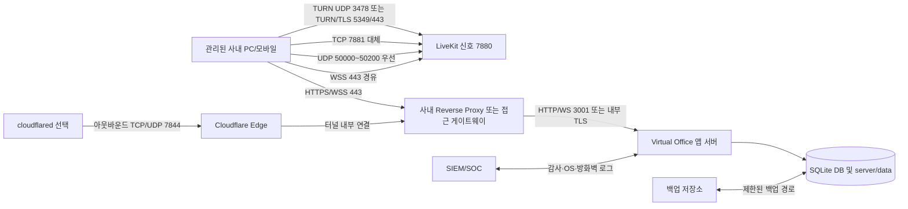

# Virtual Office 기업 보안팀 사전검토 및 네트워크 구축 가이드

> 문서 기준일: 2026-09-25  
> 대상: 고객사 정보보호팀, 네트워크팀, 인프라팀, 개인정보보호 담당자, 시스템 운영자, 공급자 기술지원팀  
> 적용 대상: Virtual Office Windows 온프레미스 운영 패키지와 고객 전용 도메인·LiveKit SFU 구성  
> 문서 목적: 도입 승인 전에 데이터 흐름, 서버 배치, 방화벽, 계정·로그·백업 정책과 남은 보안 보완점을 공동 확인한다.

---

## 1. 먼저 읽어야 할 결론

Virtual Office는 사원 명부, 조직, 근태, 채팅, 게시글, 화이트보드와 건물 구성을 고객사 SQLite DB에 저장하고, 실시간 위치·회의 상태는 WebSocket으로, 화면·카메라·음성은 **모두 내장 LiveKit SFU로만** 전달하는 온프레미스 협업 제품이다(2026-09-26부터 사용자 간 P2P 미디어·P2P 신호 경로 없음).

보안이 강한 회사에 납품할 때의 기본 결론은 다음과 같다.

1. **사내 사용자만 이용한다면 서버는 DMZ가 아니라 내부 서버 존 또는 별도 애플리케이션 VLAN에 둔다.** 사용자 PC가 있는 일반 업무망에 직접 설치하지 않는다.
2. **외근·재택 접속은 VPN 또는 회사의 ZTNA를 통과시키는 방식이 가장 보수적이다.** 이 경우에도 서버는 내부 서버 존에 두고, 외부 사용자를 내부 사용자와 동일하게 인증·통제한다.
3. **VPN 없이 인터넷 브라우저에 직접 공개해야 한다면 현재의 올인원 서버 전체를 DMZ에 두는 방식은 권장하지 않는다.** 외부 접점인 Reverse Proxy/WAF/Cloudflare Connector와 LiveKit/TURN 미디어 노드는 DMZ 또는 미디어 존에 두고, 앱·SQLite 데이터는 내부 애플리케이션 존에 두는 분리 구성이 바람직하다.
4. 현재 Windows 설치 패키지는 앱·DB·WebSocket·LiveKit을 한 서버에 묶은 올인원 구조다. 따라서 고보안 고객이 인터넷 직접 공개와 물리적 계층 분리를 동시에 요구하면 **분리형 배포 기능을 추가 개발하거나 VPN/ZTNA 방식으로 제한**해야 한다.
5. Cloudflare Tunnel은 앱과 LiveKit 신호용 HTTPS/WSS를 아웃바운드 연결로 공개할 수 있지만 **WebRTC UDP 미디어 포트를 대신 전달하는 일반 HTTP 터널이 아니다.** 외부 영상·음성까지 안정적으로 제공하려면 별도의 ICE/TCP, UDP 또는 TURN/TLS 경로를 설계해야 한다.
6. 운영 패키지에는 권한 검사, scrypt 비밀번호 해시, 로그인 시도 제한, 감사 로그, 설치별 LiveKit 키, 서명 라이선스가 구현되어 있다. 다만 고보안 기업 납품 전에는 **SSO/MFA, 설치 파일 코드서명, 보안 헤더, SIEM 연동, DB 저장 암호화, 로그인 전 사원목록 정책, 토큰 보관 방식과 독립 침투시험**을 우선 보완해야 한다.

DMZ는 **Demilitarized Zone, 비무장지대**를 뜻한다. 인터넷과 내부 업무망 사이에 두는 별도 네트워크 구역이며, 침해되더라도 내부망으로 바로 이동하지 못하도록 방화벽 정책을 양쪽에 적용한다.

NIST의 Zero Trust 원칙은 내부망이라는 위치만으로 사용자를 신뢰하지 말고 사용자·단말·자원별로 인증과 권한을 확인하도록 요구한다. 따라서 “내부망에 설치했으므로 안전하다”는 판단만으로 도입을 승인해서는 안 된다. [NIST SP 800-207 Zero Trust Architecture](https://www.nist.gov/publications/zero-trust-architecture)

---

## 2. 제품 구성과 보호해야 할 정보

### 2.1 주요 구성요소

| 구성요소 | 기본 위치/포트 | 역할 | 보안상 의미 |
|---|---:|---|---|
| Virtual Office Node 서버 | TCP 3001 | 정적 웹, REST API, WebSocket, 인증, 관리자 기능 | 핵심 업무 애플리케이션 원본 서버 |
| SQLite DB | `server/data/virtual_office.db` | 사원·조직·근태·채팅·공지·회의·설정 저장 | 개인정보와 업무 기록이 집중됨 |
| LiveKit 신호 서버 | TCP 7880 | SFU 입장과 WebRTC 신호 교환 | 브라우저에 직접 평문 노출하지 않고 TLS 프록시 권장 |
| LiveKit ICE/TCP | TCP 7881 | UDP 차단 시 미디어 대체 경로 | 외부 공개 시 방화벽 통제가 필요함 |
| LiveKit 미디어 | UDP 50000~50200 | 카메라·음성·화면 미디어 | 저지연 경로, 방화벽/NAT 설계 필요 |
| 내장 TURN(선택) | UDP 3478, TCP 5349 기본 | NAT·강한 방화벽 환경의 미디어 중계 | 고보안 원격 접속에는 TURN/TLS 권장 |
| cloudflared | 아웃바운드 TCP/UDP 7844 | 고객 고정 도메인과 내부 원본 연결 | 원본에 인터넷 인바운드 포트를 열지 않음 |
| 라이선스·인스턴스 파일 | `server/data` | 서버 신분, 계약 건물, 도메인, 터널 바인딩 | 유출·변조·삭제 방지 대상 |
| LiveKit 설치별 자격 증명 | `server/data/livekit/credentials.json` | SFU 토큰 서명 | 관리자·서비스 계정 외 읽기 금지 |

개발용 Vite 포트 TCP 5173은 운영에 필요하지 않다. 운영 서버 방화벽에서 허용하지 않는다.

### 2.2 저장되는 데이터

- 사원 이름, 이메일/로그인 ID, 부서, 직급, 전화번호 등 인사성 정보
- 비밀번호의 scrypt 단방향 해시와 salt
- 출퇴근·근태 기록
- 공지, 게시글, 채팅, 화이트보드 메모
- 회의 일정, 회의 참가 상태, 화면공유 상태
- 사무실·학교 등 건물/방/가구 배치 프리셋
- 관리자 변경 작업과 로그인 관련 감사 로그
- 라이선스, 설치 인스턴스 키, Cloudflare Tunnel 토큰, LiveKit API secret

### 2.3 실시간으로 흐르지만 기본적으로 중앙 녹화되지 않는 데이터

- 화면공유 영상
- 카메라 영상
- 마이크 음성
- 캐릭터 위치, 착석, 회의 참가·발언 상태

화면·카메라·음성은 전송 중 암호화되는 WebRTC 경로를 사용하지만, 현재 제품에 대해 종단간 암호화(E2EE)가 적용되었다고 주장해서는 안 된다. SFU 운영자는 미디어 전송 계층의 신뢰 경계 안에 포함된다. 회의 녹화는 현재 주최자 브라우저의 로컬 저장 방식이며, 중앙 녹화 저장소·보존기간·재생 권한은 기본 제공 범위가 아니다.

### 2.3.1 실시간 미디어 전송 구조 (모두 LiveKit SFU)

2026-09-26 버전부터 사용자 단말끼리 직접 연결(P2P)하는 미디어 경로와 P2P 신호 중계를 모두 제거했다. 음성·카메라·화면공유는 서버가 발급한 단기 토큰으로 접속하는 LiveKit 방에서만 흐르며, 사용자 PC의 IP·ICE 후보가 다른 사용자에게 전달되지 않는다.

| 기능 | LiveKit 방 | 받는 사람 | 발행 권한(토큰) |
|---|---|---|---|
| 회의실 화면공유(영상 + 공유 소리) | 회의실별 방 `vo-screen-*` | 그 회의실 스크린을 보는 사람 | 발표자(presenter)만 |
| 회의 창 마이크·카메라 | 같은 회의실 방 | 회의 창에 참여한 사람만 | 회의 참가자(meeting)·발표자 |
| 1:1 화면공유(영상 + 공유 소리) | 두 사람 전용 방 `vo-direct-<해시>` | 두 사람 | 두 사람 |
| 1:1 음성·영상 통화 | 같은 두 사람 전용 방 | 두 사람(수락 후) | 두 사람 |
| 방 안 근처 대화(음성) | 방별 방 `vo-near-<해시>` | 같은 방 안 가까운 사람(2.5m 선명, 4m 밖 무음) | 관리자가 허용한 방에서만 마이크 |
| 방 안 머리 위 카메라 | 같은 방별 방 | 같은 방 사람 | 항상(카메라만) |
| 타운홀 세미나 | 세미나 세션 방 | 참가자 | 호스트·발표자·승인된 발언자 |

**격리 원칙**
- 방 이름은 서버가 거래처·건물·방(또는 두 사용자 ID)으로 계산한다. 클라이언트가 임의의 방 이름을 고를 수 없다.
- 근처 대화·방 카메라 토큰은 서버가 WebSocket으로 알고 있는 사용자의 **현재 방**과 요청한 방이 같을 때만 발급한다. 방·층을 옮기거나 접속이 끊기면 서버가 이전 방에서 참가자를 강제 퇴장시킨다.
- 1:1 방 토큰은 로그인한 두 사람이 모두 접속해 있고 같은 건물일 때만 발급한다.
- 관리자가 근처 대화를 끄면 서버가 해당 LiveKit 방을 닫고, 이후 토큰에는 마이크 권한을 넣지 않는다.
- 로그아웃하면 서버가 그 세션의 WebSocket을 닫아 모든 사람 화면에서 즉시 퇴장 처리한다.
- 한 사용자는 한 번에 하나의 음성 채널(회의 > 1:1 통화 > 근처 대화)에만 마이크를 보낸다.

**알려진 한계(보안 검토 시 명시)**
- LiveKit 토큰은 "발행 가능한 트랙 종류"는 제한하지만 "구독 가능한 트랙 종류"는 제한하지 못한다. 같은 회의실 방에 3D 스크린만 보려고 접속한 사람이 회의 음성을 받지 않는 것, 같은 방 안에서 5m 밖 사람의 음성을 받지 않는 것은 **클라이언트 구독 설정**으로 보장된다. 서버 수준 격리가 필요하면 "화면 시청 방"과 "회의 방"을 분리하는 추가 개발이 필요하다.
- 방 간·층 간·회의/근처 대화/1:1 간 격리는 서로 다른 LiveKit 방이므로 서버(SFU) 수준에서 보장된다.

### 2.4 데이터 등급 권고

고객 보안팀은 최소 다음처럼 분류한다.

| 데이터 | 권고 등급 | 비고 |
|---|---|---|
| 사원 명부·근태·전화번호 | 개인정보/사내기밀 | 개인정보 처리방침과 보존기간 필요 |
| 채팅·화이트보드·화면공유 | 사내기밀 이상 | 화면에 영업비밀·소스·고객정보가 포함될 수 있음 |
| 감사 로그 | 보안정보 | 관리자도 임의 삭제하지 못하도록 외부 보관 권장 |
| LiveKit secret·Tunnel token·인스턴스 개인키 | 인증비밀 | 메일·메신저·티켓에 평문 첨부 금지 |
| 건물 프리셋·라이선스 | 운영설정 | 서명 검증과 변경 이력 관리 |

---

## 3. 통신 흐름과 신뢰 경계



보안팀은 다음 신뢰 경계를 따로 승인한다.

1. 사용자 단말 ↔ 접근 게이트웨이
2. 접근 게이트웨이 ↔ Virtual Office 원본
3. 사용자 단말 ↔ LiveKit/TURN 미디어 노드
4. 앱 프로세스 ↔ SQLite 및 비밀 파일
5. cloudflared ↔ Cloudflare Edge
6. 운영 서버 ↔ 백업·SIEM·패치 저장소

---

## 4. 서버 배치 선택

### 4.1 시나리오 A — 사내망 전용: 가장 단순하고 권장

서버를 **내부 서버 존/애플리케이션 VLAN**에 둔다. 사용자 PC와 같은 VLAN에 두지 않는다. 사내 Reverse Proxy 또는 L7 로드밸런서에서 회사 인증서로 HTTPS를 종료하고 앱 서버의 3001과 LiveKit 7880으로 전달한다.

장점:

- 외부 인터넷에서 앱 원본에 접근할 수 없다.
- 사원·근태·채팅 DB가 내부 존에 머문다.
- 외부용 TURN·공인 미디어 포트를 생략할 수 있다.
- 방화벽 출발지 주소를 회사 관리 단말 VLAN으로 제한할 수 있다.

주의:

- 브라우저 화면공유·카메라·마이크는 HTTPS 보안 컨텍스트가 필요하다. `http://사내IP:3001`을 운영 표준으로 사용하지 않는다.
- 사내 DNS에 앱용 FQDN과 신뢰 가능한 인증서를 구성한다.
- 사용자 VLAN에서 앱 서버의 관리 포트, 파일 시스템, RDP에 접근하지 못하게 한다.

### 4.2 시나리오 B — 재택/외근: VPN 또는 ZTNA 권장

외부 사용자는 회사 VPN 또는 ZTNA에 먼저 인증한 다음 내부 FQDN으로 접속한다. 관리자와 일반 사용자 모두 MFA와 단말 보안 상태를 통과해야 한다.

이 방식이 고보안 회사에 가장 적합한 이유:

- Virtual Office 원본과 SQLite를 인터넷에 직접 공개하지 않는다.
- 회사가 기존 VPN/ZTNA의 MFA, 단말 인증서, EDR 상태, 국가/IP 정책을 재사용할 수 있다.
- 접속 로그와 차단 정책을 기존 SOC 체계에 통합하기 쉽다.

VPN에서 UDP를 제한하면 영상·음성이 TCP 7881로 폴백하여 품질이 떨어질 수 있다. VPN 주소 풀에서 LiveKit UDP 50000~50200 또는 사내 TURN/TLS로 접근할 수 있도록 시험한다.

### 4.3 시나리오 C — 인터넷 직접 공개: DMZ 분리형

인터넷 브라우저에서 VPN 없이 접속해야 할 때의 권장 배치는 다음과 같다.

| 구역 | 배치 구성요소 | 원칙 |
|---|---|---|
| 인터넷/Cloud Edge | WAF, DDoS 방어, 인증 게이트웨이 | TLS, MFA, IP/국가/봇 정책 적용 |
| DMZ 또는 Edge Connector 존 | Reverse Proxy 또는 cloudflared | 내부 앱으로 필요한 경로만 전달 |
| DMZ 또는 별도 Media 존 | LiveKit SFU, TURN | 공개 UDP/TCP를 받는 구성요소 격리 |
| 내부 애플리케이션 존 | Node 앱/API/WebSocket | DMZ 프록시에서 오는 통신만 허용 |
| 내부 데이터 영역 | SQLite와 `server/data` | 앱 서비스 계정만 접근, 사용자/DMZ 직접 접근 금지 |

**현재 올인원 Windows 설치형은 앱·DB·LiveKit을 한 호스트에서 실행한다.** 이 호스트를 통째로 DMZ에 놓으면 개인정보 DB와 비밀키도 DMZ에 들어가므로 고보안 고객에는 권장하지 않는다. 다음 중 하나를 선택한다.

1. 외부 접속을 VPN/ZTNA로 제한하고 올인원 서버를 내부 존에 둔다.
2. 공급자와 협의하여 LiveKit/TURN·Edge와 앱/데이터를 분리하는 엔터프라이즈 배포형을 구축한다.
3. 위험 승인 후 제한적으로 올인원 서버를 격리 DMZ에 두되, 내부망 연결을 전부 차단하고 암호화 백업·EDR·WAF·엄격한 접근제어를 적용한다. 이 안은 예외안이지 기본 권고안이 아니다.

### 4.4 Cloudflare Tunnel을 쓰는 경우

Cloudflare Tunnel은 `cloudflared`가 외부로 먼저 연결하므로 앱 원본에 인터넷 인바운드 포트를 열지 않아도 된다. 공식 문서 기준 기본 연결은 TCP/UDP 7844의 HTTP/2 또는 QUIC이다. [Cloudflare Tunnel 연결 방식](https://developers.cloudflare.com/cloudflare-one/networks/connectivity-options/), [Cloudflare Tunnel 개요](https://developers.cloudflare.com/tunnel/)

보안팀 확인사항:

- 임시 `trycloudflare.com` Quick Tunnel은 운영에서 금지한다. 현재 운영 프로파일도 `VO_ALLOW_QUICK_TUNNEL=1`을 명시하지 않으면 임시 터널을 허용하지 않는다.
- 라이선스에 서명된 고객 전용 앱·미디어 호스트명과 Named Tunnel만 사용한다.
- Tunnel 토큰은 서비스 계정만 읽을 수 있게 하고 SIEM·티켓·화면 캡처에 남기지 않는다.
- Cloudflare Access/WAF 정책을 적용해도 원본 3001에 사용자가 직접 접근할 수 있으면 인증을 우회할 수 있다. 원본 방화벽은 Reverse Proxy/cloudflared 로컬 경로만 허용한다.
- Cloudflare Edge에서 TLS가 종료되는 구조와 고객 데이터가 외부 사업자 경계를 통과하는 사실을 개인정보·국외이전·위탁 처리 관점에서 승인받는다.
- HTTP/WSS 터널 성공만으로 외부 WebRTC 미디어 성공을 보장하지 않는다. 별도 ICE/TCP·UDP·TURN 실기 시험이 필요하다.

---

## 5. 방화벽 허용 정책

### 5.1 공통 원칙

- 기본 정책은 `deny all`로 두고 아래 필요한 흐름만 허용한다.
- `Any → 서버` 규칙을 만들지 않는다. 출발지 VLAN, VPN 주소 풀, 프록시 IP, 관리 점프서버 IP를 명시한다.
- 앱 원본 TCP 3001과 LiveKit 신호 TCP 7880은 인터넷에 직접 노출하지 않는다.
- 관리용 RDP/WinRM/SMB는 사용자망에서 차단하고 관리 VLAN의 점프서버에서만 허용한다.
- 개발 포트 5173, 디버거 포트, SQLite 파일 공유는 운영망에서 차단한다.
- 방화벽 로그를 남기고 거부 급증, 미디어 포트 스캔, 관리 포트 접근을 경보화한다.

LiveKit 공식 문서는 API/WebSocket 7880을 TLS 종료 장비 뒤에 두고, ICE/UDP와 ICE/TCP 또는 TURN을 외부에서 접근 가능하게 구성하도록 안내한다. 이 제품은 공식 기본 UDP 범위보다 좁은 50000~50200을 사용한다. [LiveKit 포트 및 방화벽](https://docs.livekit.io/transport/self-hosting/ports-firewall/)

### 5.2 사내망 전용 권장 규칙

| 출발지 | 목적지 | 방향 | 프로토콜/포트 | 필수 | 설명 |
|---|---|---|---:|---|---|
| 관리된 사내 사용자 VLAN | 사내 Reverse Proxy VIP | Inbound | TCP 443 | 필수 | 웹/API/WSS 단일 진입점 |
| Reverse Proxy | Virtual Office 서버 | 내부 | TCP 3001 | 필수 | 출발지를 프록시 IP로만 제한 |
| Reverse Proxy | LiveKit 서버 | 내부 | TCP 7880 | 필수 | WSS 신호 프록시 |
| 관리된 사내 사용자/VPN VLAN | LiveKit 서버 | 내부 | UDP 50000~50200 | 권장 | 주 미디어 경로 |
| 관리된 사내 사용자/VPN VLAN | LiveKit 서버 | 내부 | TCP 7881 | 필수 대체 | UDP 차단 시 ICE/TCP |
| 관리된 사내 사용자/VPN VLAN | TURN 서버 | 내부 | UDP 3478 | 선택 | TURN/UDP |
| 관리된 사내 사용자/VPN VLAN | TURN 서버 | 내부 | TCP 5349 또는 443 | 강한 방화벽에서 권장 | TURN/TLS. 인증서와 별도 도메인 필요 |
| 관리 점프서버 | Virtual Office 서버 | 내부 | RDP 3389 또는 조직 표준 관리 포트 | 선택 | 일반 사용자 VLAN에서는 금지 |
| 서버 | 사내 DNS/NTP | Outbound | 조직 표준 | 필수 | 이름 해석과 정확한 인증·감사 시간 |
| 서버 | 사내 백업·SIEM·패치 저장소 | Outbound | 조직 지정 | 권장 | 목적지와 서비스 계정 제한 |

같은 호스트에서 TURN/TLS 443과 웹 Reverse Proxy 443을 동시에 직접 열 수 없다면 별도 IP, L4 로드밸런서 또는 별도 TURN 노드가 필요하다.

### 5.3 Cloudflare Named Tunnel 규칙

| 출발지 | 목적지 | 방향 | 프로토콜/포트 | 필수 | 설명 |
|---|---|---|---:|---|---|
| cloudflared 호스트 | Cloudflare Tunnel 엔드포인트 | Outbound | UDP 7844 | 권장 | QUIC |
| cloudflared 호스트 | Cloudflare Tunnel 엔드포인트 | Outbound | TCP 7844 | 필수 폴백 | HTTP/2. UDP 차단 시 사용 |
| cloudflared 호스트 | 회사 DNS 또는 승인 DNS | Outbound | TCP/UDP 53 또는 조직 표준 | 필수 | Tunnel 엔드포인트 이름 해석 |
| cloudflared 호스트 | `api.cloudflare.com` | Outbound | TCP 443 | 선택/관리 | 관리 API·업데이트 정책에 따라 허용 |
| 인터넷 | Virtual Office 원본 3001 | Inbound | 차단 | 필수 | 터널 사용 시 직접 공개 금지 |
| 인터넷 | LiveKit 원본 7880 | Inbound | 차단 | 필수 | WSS는 승인된 프록시/터널을 경유 |

Cloudflare 공식 진단 기준으로 UDP 7844가 막히면 TCP 7844로 폴백하며 둘 다 막히면 터널이 동작하지 않는다. 목적지는 고객 방화벽 정책에 맞춰 Cloudflare가 게시한 Tunnel IP/FQDN 목록으로 제한한다. [Cloudflare Tunnel 연결 문제 해결](https://developers.cloudflare.com/tunnel/troubleshooting/), [연결 사전 검사](https://developers.cloudflare.com/cloudflare-one/networks/connectors/cloudflare-tunnel/troubleshoot-tunnels/connectivity-prechecks/)

### 5.4 인터넷 공개 미디어 규칙

| 출발지 | 목적지 | 방향 | 프로토콜/포트 | 필수 | 설명 |
|---|---|---|---:|---|---|
| 승인된 외부 사용자/인터넷 | 미디어 공인 IP | Inbound | UDP 50000~50200 | 품질 권장 | LiveKit ICE/UDP |
| 승인된 외부 사용자/인터넷 | 미디어 공인 IP | Inbound | TCP 7881 | 대체 필수 | UDP 실패 시 ICE/TCP |
| 승인된 외부 사용자/인터넷 | TURN 공인 IP | Inbound | UDP 3478 | 선택 | TURN/UDP |
| 승인된 외부 사용자/인터넷 | TURN 공인 IP | Inbound | TCP 5349 또는 443 | 권장 | TURN/TLS |
| Edge/WAF/승인 프록시 | LiveKit 신호 | Inbound | TCP 7880 | 필수 | 원본에는 Edge IP만 허용 |

LiveKit은 연결을 대체로 ICE/UDP → TURN/UDP → ICE/TCP → TURN/TLS 순으로 시도한다. 강한 기업 방화벽에서는 TURN/TLS가 마지막 연결 수단이다. [LiveKit 연결 신뢰성](https://docs.livekit.io/intro/basics/connect/), [LiveKit 자체 호스팅 배포](https://docs.livekit.io/transport/self-hosting/deployment/)

### 5.5 Windows Defender Firewall 예시

아래 값은 예시다. 실제 사내 사용자 대역과 프록시 IP로 반드시 바꾼다.

```powershell
# 앱 원본: Reverse Proxy 한 대만 접근
New-NetFirewallRule `
  -DisplayName 'Virtual Office App from Reverse Proxy' `
  -Direction Inbound -Action Allow -Protocol TCP -LocalPort 3001 `
  -RemoteAddress 10.20.10.15 -Profile Domain

# LiveKit UDP: 관리 단말이 있는 사내/VPN 대역만 접근
New-NetFirewallRule `
  -DisplayName 'Virtual Office LiveKit Media UDP' `
  -Direction Inbound -Action Allow -Protocol UDP -LocalPort 50000-50200 `
  -RemoteAddress 10.30.0.0/16,10.40.0.0/16 -Profile Domain

# UDP 차단 환경의 대체 경로
New-NetFirewallRule `
  -DisplayName 'Virtual Office LiveKit ICE TCP' `
  -Direction Inbound -Action Allow -Protocol TCP -LocalPort 7881 `
  -RemoteAddress 10.30.0.0/16,10.40.0.0/16 -Profile Domain
```

규칙을 만들기 전후에 `Get-NetFirewallRule`, `Get-NetTCPConnection`, 방화벽 로그와 실제 단말 시험으로 범위를 확인한다. 사용하지 않는 규칙은 즉시 비활성화한다.

---

## 6. 서버와 운영체제 보안 강화

### 6.1 호스트 기준

- 전용 Windows Server 또는 전용 VM을 사용한다. 개발도구, 메일, 웹브라우징, 일반 사용자 작업을 함께 하지 않는다.
- 회사 표준 EDR/EPP, 취약점 스캐너, Windows Update/WSUS 정책을 적용한다.
- 로컬 Administrators 그룹을 최소화하고, 서비스는 별도 비대화형 계정으로 실행한다.
- RDP는 관리 VLAN의 점프서버에서만 MFA를 거쳐 허용한다. 인터넷 RDP는 금지한다.
- 불필요한 SMB, 프린터, 원격 레지스트리, 개발 포트를 비활성화한다.
- 서버 시간은 사내 NTP와 동기화한다. 시간 불일치는 라이선스, 토큰, 감사 로그 분석을 깨뜨린다.
- AppLocker 또는 WDAC를 사용할 경우 패키지의 실행 파일과 해시/서명 승인 절차를 만든다.

### 6.2 파일과 비밀정보 권한

다음 경로는 앱 서비스 계정과 지정 관리자만 읽도록 NTFS ACL을 설정한다.

- `server/data/virtual_office.db` 및 SQLite WAL/SHM 파일
- `server/data/license-instance.json`
- 등록된 `.calamus-license`와 pending 라이선스
- `server/data/livekit/credentials.json`
- `server/data/livekit/livekit.runtime.yaml`
- `server/data/cloudflared/token`
- `server/data/cloudflared/tunnel.json`

Windows에서 Node의 `0600` 모드만으로 권한 통제가 충분하다고 가정하지 않는다. 설치 후 NTFS ACL을 실제로 확인한다.

### 6.3 저장 암호화

현재 SQLite DB는 애플리케이션 자체 DB 암호화를 적용하지 않는다. 비밀번호는 scrypt 해시이지만 채팅·근태·인사 데이터는 DB 파일 안에서 평문 데이터로 조회될 수 있다.

고보안 고객의 최소 조치:

- 서버 볼륨에 BitLocker 또는 조직 표준 디스크 암호화를 적용한다.
- 복구키는 AD/Azure AD/보안 금고 등 회사 표준으로 위탁 보관한다.
- 백업 파일도 별도 키로 암호화한다.
- 운영 DB를 일반 파일 공유로 노출하지 않는다.
- 장기적으로 SQLCipher 또는 외부 암호화 DB 지원 여부를 제품 로드맵에서 검토한다.

### 6.4 TLS

- 사용자는 `https://` FQDN만 사용한다.
- 회사 PKI 또는 공인 CA가 발급한 인증서를 사용한다.
- TLS 1.2 이상을 허용하고 취약 암호군을 제거한다.
- 앱 원본까지 HTTP로 전달하는 경우에도 그 구간을 별도 서버 VLAN으로 제한한다. 보안팀이 종단간 TLS를 요구하면 Reverse Proxy ↔ 앱, Proxy ↔ LiveKit도 TLS로 구성해야 한다.
- TURN/TLS 인증서의 CN/SAN은 TURN 도메인과 일치해야 한다.
- 인증서 만료 30일 전 경보와 갱신 책임자를 지정한다.

---

## 7. 계정·인증·권한 관리

### 7.1 현재 제공되는 통제

- 운영 패키지는 고정 기본 관리자 계정을 포함하지 않고 최초 설치 시 일회성 bootstrap token으로 관리자를 생성한다.
- 비밀번호는 salt가 포함된 scrypt 해시로 저장한다.
- 운영 프로파일은 API와 WebSocket 세션 인증, 사용자 사칭 차단, 관리자 capability 검사를 수행한다.
- 세션은 32바이트 난수 기반 Bearer token이며 기본 24시간 후 만료한다.
- 로그인 실패 횟수 제한과 관리자 작업 감사 로그가 있다.
- LiveKit 토큰은 서버가 회의·방·역할을 확인한 뒤 단기 발급한다.
- 라이선스와 계약 건물/도메인은 Ed25519 서명으로 무결성을 검증한다.

### 7.2 고보안 납품 전 보완 또는 보완통제

| 항목 | 현행 | 고보안 고객 요구 |
|---|---|---|
| SSO | 미구현 | OIDC 또는 SAML로 고객 IdP 연동 |
| MFA | 앱 자체 미구현 | 관리자와 원격 접속자에게 피싱 저항성 MFA 필수 |
| 세션 토큰 | 브라우저 sessionStorage와 localStorage에 Bearer token 저장 | HttpOnly/Secure/SameSite 쿠키 또는 BFF 패턴 검토, XSS 방어 강화 |
| 세션 만료 | 24시간 인메모리 | 유휴 만료, 절대 만료, 재인증, 관리자 강제 종료 정책 추가 |
| 비밀번호 정책 | 최소 8자 중심 | 조직 정책, 유출 비밀번호 차단, 잠금·재설정·이력 정책 |
| 로그인 전 명부 | 공개 로그인 목록 API가 이름·직무·온라인 상태를 제공 | 운영 옵션으로 비활성화하거나 사번 직접 입력/SSO로 대체 |
| 권한 | 관리자/사원 capability 기반 | 고객 직무분리표와 정기 권한 재검토 |

SSO/MFA 개발 전 임시 보완은 Reverse Proxy, VPN 또는 Cloudflare Access에서 IdP MFA를 강제하고 원본 우회 경로를 방화벽으로 막는 것이다. 단, 게이트웨이 MFA는 앱 내부의 관리자 권한 오남용을 대신 통제하지 못하므로 네이티브 SSO와 세분화된 권한이 최종 목표다.

CISA는 관리자와 원격 접속에 MFA를 요구하고, 엔터프라이즈 제품은 SAML/OIDC 기반 SSO와 안전한 감사 로그를 제공하도록 권고한다. [CISA MFA 가이드](https://www.cisa.gov/audiences/small-and-medium-businesses/secure-your-business/require-multifactor-authentication), [CISA Secure by Design 원칙](https://www.cisa.gov/sites/default/files/2023-06/principles_approaches_for_security-by-design-default_508c.pdf)

### 7.3 입·퇴사와 권한 검토

- HR 기준정보와 계정 소유자를 일치시킨다.
- 퇴사자는 당일 비활성화하고 기존 세션을 무효화한다.
- 부서 이동 시 팀·층·관리자 권한을 재검토한다.
- 관리자 계정은 일반 업무 계정과 분리한다.
- 분기별로 관리자·감사조회·건물편집·라이선스관리 권한을 검토한다.
- 공유 계정 사용을 금지한다.

---

## 8. 애플리케이션 보안 검토 결과

### 8.1 현재 확인된 강점

- 운영판 최초 관리자 생성은 일회성 bootstrap 절차를 사용한다.
- 비밀번호를 scrypt로 단방향 해시한다.
- API와 WebSocket에서 세션과 요청 사용자 일치를 검사한다.
- 관리자 기능을 capability로 구분하고 감사 이벤트를 남긴다.
- 로그인 rate limit가 적용된다.
- LiveKit API key/secret은 패키지 공용값이 아니라 설치마다 생성한다.
- 운영 패키지 안전성 검사에서 런타임 DB, 비밀 YAML, 고정 키 유입을 차단한다.
- 화면공유 방과 발표자 권한을 서버에서 검증하고 LiveKit 토큰을 서버에서 발급한다.
- 회의·1:1·근처 대화·방 카메라 모두 서버가 방 이름과 발행 가능한 트랙 종류(마이크·카메라·화면)를 정해 단기 토큰을 발급한다.
- 사용자 간 P2P 미디어와 P2P 신호 중계가 없어 사용자 PC의 IP가 다른 사용자에게 노출되지 않는다.
- 로그아웃·방 이동·관리자 설정 변경 시 서버가 LiveKit 참가자·방을 즉시 정리한다.
- 라이선스에 설치 인스턴스, 도메인, 터널, 건물 프로필을 서명하여 변조를 차단한다.
- 운영 프로파일은 Quick Tunnel을 기본 차단한다.

### 8.2 납품 전 우선 보완해야 할 항목

다음은 네트워크 설정만으로 완전히 해결되지 않는 제품 보완사항이다.

1. **설치 파일 Authenticode 코드서명**  
   2026-09-25 생성한 `Setup.exe`, `VirtualOfficeServer.exe`, `VirtualOfficeClient.exe`는 현재 `NotSigned`로 확인됐다. EV 또는 조직이 승인한 코드서명 인증서와 타임스탬프를 적용하고 배포 해시를 공개해야 한다.
2. **SSO와 MFA**  
   OIDC/SAML 연동과 관리자 MFA가 필요하다.
3. **브라우저 토큰 보호**  
   localStorage의 Bearer token은 XSS 시 탈취될 수 있으므로 HttpOnly cookie 또는 BFF 구조를 검토한다.
4. **보안 응답 헤더**  
   CSP, HSTS, `X-Content-Type-Options`, `Referrer-Policy`, `Permissions-Policy`, clickjacking 방어를 Reverse Proxy와 앱에 적용한다.
5. **CORS 최소화**  
   현행 서버는 localhost, RFC1918 사설 IP와 라이선스 도메인을 허용한다. 고객 운영 모드에서는 정확한 HTTPS FQDN만 허용하도록 좁혀야 한다.
6. **로그인 전 사원목록 최소화**  
   `/api/public/login-roster`의 이름·역할·층·온라인 표시를 고객 정책에 따라 숨길 수 있어야 한다.
7. **요청 본문·업로드 방어**  
   JSON/CSV/이미지/프리셋 업로드에 명시적 크기 제한, MIME/확장자/스키마 검증, 악성코드 검사와 압축폭탄 방어를 적용한다.
8. **SIEM 연동과 변조 방지 로그**  
   감사 로그가 같은 SQLite에 있으므로 원격 syslog/CEF/JSON 또는 API로 즉시 반출하고 별도 보존한다.
9. **DB 자체 암호화 또는 보완통제**  
   최소 BitLocker·NTFS ACL·암호화 백업을 적용한다.
10. **미디어 감사·녹화 정책**
    회의실·1:1 화면공유·1:1 통화·근처 대화·방 카메라는 모두 LiveKit SFU를 거친다(P2P 제거 완료). 다만 1:1·근처 대화에 대한 중앙 녹화나 통화 내역 감사 화면은 기본 제공 범위가 아니므로, 고보안 고객은 통화 기록 보존·DLP 요구를 별도로 정의한다. 근처 음성 대화는 관리자 콘솔에서 건물 전체 또는 방별로 끌 수 있다.
11. **SBOM·SCA·취약점 대응**  
    Node, LiveKit, cloudflared, SQLite, Three.js 등 포함 구성요소의 SBOM과 CVE 대응 SLA가 필요하다.
12. **독립 보안시험**  
    인증·인가·WebSocket·파일 업로드·XSS·CSRF·SSRF·경로순회·LiveKit 토큰을 포함한 소스 점검과 침투시험이 필요하다.

이 항목이 완료되지 않은 상태에서 “보안 인증을 받았다”, “E2EE다”, “금융/국방 기준을 충족한다”고 표현하지 않는다.

---

## 9. 로그·모니터링·탐지

### 9.1 수집할 로그

- Virtual Office 로그인 성공/실패, 로그아웃, 비밀번호 변경
- 최초 관리자 생성과 관리자 권한 변경
- 사원·팀·건물·프리셋 변경
- 라이선스 요청·등록·실패·만료
- LiveKit 토큰 발급, 발표자 예약 충돌, 화면공유 시작·종료
- WebSocket 인증 실패와 비정상 종료
- Windows Security/System/Application Event Log
- Defender/EDR 탐지와 격리 기록
- Reverse Proxy/WAF/Cloudflare Access 로그
- 방화벽 허용·차단, VPN/ZTNA 인증 로그
- LiveKit 연결 실패, TURN 사용률, 대역폭·CPU·메모리·디스크
- 백업 성공/실패와 복원 시험 결과

### 9.2 경보 예시

- 동일 계정 또는 IP에서 로그인 실패 급증
- 관리자 계정의 평소와 다른 IP·시간대 접속
- 사원 대량 등록·삭제, 건물 프리셋 대량 변경
- 라이선스·터널·LiveKit 자격 증명 파일 변경
- 새로운 프로세스가 3001/7880/7881/3478/50000~50200을 수신
- 외부에서 3001·7880·3389로 직접 접근 시도
- UDP 미디어 대역폭 급증 또는 비정상 장시간 세션
- 감사 로그 수집 중단 또는 시간 역행
- DB·백업 파일의 비정상 대량 읽기

로그는 서버 로컬에만 두지 말고 SIEM 또는 쓰기 보호 저장소에 전송한다. 보존기간은 개인정보·노동·금융·공공 등 고객의 법적 의무에 따라 정한다. CISA도 사용자 활동, 관리자 변경, 로그인과 네트워크 흐름을 중앙 수집하고 고위험 이벤트를 경보화하도록 권고한다. [CISA Logging and Monitoring](https://www.cisa.gov/audiences/small-and-medium-businesses/secure-your-business/use-logging-on-business-systems)

---

## 10. 백업·복구·랜섬웨어 대응

### 10.1 백업 대상

`virtual_office.db` 하나만 복사하면 충분하다고 가정하지 않는다. 서버를 정상 중지하거나 SQLite 일관성 백업 절차를 사용하고 다음을 함께 보호한다.

- `server/data` 전체
- SQLite DB, `-wal`, `-shm` 등 존재하는 부속 파일
- `license-instance.json`과 등록·pending 라이선스
- LiveKit credentials와 runtime YAML
- cloudflared tunnel 설정과 token
- 고객 인증서와 Reverse Proxy 설정
- Windows 방화벽·서비스·작업 스케줄러 설정
- 건물 프리셋의 별도 JSON 내보내기

### 10.2 운영 원칙

- 3-2-1 원칙에 따라 운영본 외 2개 이상 복사본, 다른 매체, 1개 오프라인/불변 백업을 유지한다.
- 백업은 운영 서버와 다른 관리자 자격 증명을 사용한다.
- 백업 파일을 암호화하고 복구키를 별도 금고에 둔다.
- 월 1회 이상 격리 환경에서 복원 시험을 수행한다.
- RPO/RTO를 고객이 결정하고 시험 결과를 기록한다.
- `license-instance.json` 유실 또는 새 서버 이전 시 라이선스 재발급이 필요할 수 있음을 복구 절차에 포함한다.
- 랜섬웨어 사고 시 운영 서버를 즉시 격리하고 백업 저장소가 같은 자격 증명으로 침해되지 않았는지 먼저 확인한다.

---

## 11. 변경·패치·공급망 보안

### 11.1 납품물

공급자는 릴리스마다 다음을 제공하는 것이 바람직하다.

- 버전과 빌드 일시
- Authenticode 서명된 설치 파일
- SHA-256 해시
- SBOM(CycloneDX 또는 SPDX)
- 변경 이력과 보안 수정 내역
- 알려진 취약점과 영향·완화책
- 지원 종료일과 긴급 패치 SLA
- 설치·업데이트·롤백·백업 절차

### 11.2 고객 검증

1. 별도 스테이징 서버에서 해시와 서명을 확인한다.
2. EDR·백신·취약점 스캔을 수행한다.
3. 방화벽·Proxy·LiveKit 연결과 기능 회귀시험을 한다.
4. `server/data`를 백업한다.
5. 승인된 변경 시간에 업데이트한다.
6. 로그인, 권한, 채팅, 회의, 화면공유, 백업을 점검한다.
7. 문제 시 롤백하고 사고·변경 티켓에 기록한다.

CISA의 소프트웨어 도입 지침은 공급자의 패치 프로세스, 패치 이력, 로그 제공, 취약점 대응 시간을 구매 단계에서 확인하도록 권고한다. [CISA Software Acquisition Guide](https://www.cisa.gov/sites/default/files/2024-07/PDM24050%20Software%20Acquisition%20Guide%20for%20Government%20Enterprise%20ConsumersV2_508c.pdf)

---

## 12. 개인정보·회의·DLP 정책

- 사원에게 수집 항목, 목적, 보존기간, 열람 권한을 고지한다.
- 채팅·근태·게시글·화이트보드의 삭제 및 법적 보존 정책을 정한다.
- 화면공유 시 다른 모니터, 알림, 비밀번호 관리자, 고객정보가 노출되지 않도록 교육한다.
- 카메라·마이크는 사용자가 명시적으로 켜고 끌 수 있어야 하며 브라우저·OS 권한도 최소화한다.
- 녹화 시작 전 참석자에게 알리고, 녹화 파일은 현재 브라우저 로컬에 저장된다는 점을 공지한다.
- DLP가 필요한 조직은 브라우저 업로드, 클립보드, 화면 캡처, 로컬 녹화 파일을 단말 정책으로 통제한다.
- 외부 참석자와 타운홀 게스트 기능은 별도 승인하고, 초대 코드 만료·회수·감사 정책을 둔다.
- 방 안 근처 음성 대화(기본 꺼짐)의 사용 여부와 허용할 방을 보안팀·총무팀이 정하고 관리자 콘솔 "방별 시설 관리"에서 설정한다.
- 1:1 통화는 상대가 수락해야 연결되며, 회의 중인 사람에게는 걸리지 않는다는 점을 사용자에게 안내한다.

---

## 13. 보안 사고 대응

### 13.1 의심 징후

- 모르는 관리자·사원·회의 참가자가 보임
- 화면공유가 다른 방에 나타나거나 승인되지 않은 녹화가 발생함
- 라이선스·터널 도메인이 갑자기 바뀜
- LiveKit 토큰 발급·연결 실패가 급증함
- DB, token, credentials 파일의 수정 시간이 예고 없이 바뀜
- 서버에 새로운 수신 포트나 cloudflared 프로세스가 생김

### 13.2 초기 대응

1. 서버 전원을 바로 끄기보다 네트워크 격리와 메모리/로그 보존 여부를 사고대응팀이 결정한다.
2. 외부 Tunnel, Reverse Proxy route, VPN/ZTNA 접근을 차단한다.
3. 관리자 세션과 사용자 세션을 무효화한다.
4. LiveKit API key/secret, Tunnel token, 관리자 비밀번호를 순서대로 회전한다.
5. 라이선스·인스턴스 키 유출 여부를 공급자와 확인한다.
6. SIEM, WAF, 방화벽, Windows, 앱 감사 로그의 동일 시간대를 수집한다.
7. 깨끗한 서버에 검증된 패키지와 백업으로 복구한다.
8. 재개 전 외부 단말 2대 이상으로 앱·화상·화면공유를 검증한다.

비밀값은 장애 티켓, 이메일, 채팅, 화면 캡처에 붙이지 않는다. 지원이 필요하면 비밀값을 제거한 진단 로그와 발생 시각, 사용자, 방 ID, 앱·미디어 도메인을 전달한다.

---

## 14. 공급자와 고객사의 책임 구분

| 영역 | 공급자 | 고객사 보안/IT | 공동 |
|---|---|---|---|
| 제품 코드 | 인증·인가, 안전한 기본값, 취약점 수정 | 승인 버전만 사용 | 위협 모델 검토 |
| 설치 파일 | 코드서명, 해시, SBOM, 변경 이력 | 서명·해시·백신 확인 | 릴리스 승인 |
| 서버 OS | 지원 OS와 필수 조건 안내 | 패치, EDR, 계정, BitLocker, NTFS ACL | 하드닝 점검 |
| 네트워크 | 필요 흐름과 포트 문서화 | VLAN, DMZ, WAF, VPN/ZTNA, 방화벽 | 외부망 실기 시험 |
| 인증 | SSO/MFA 연동 기능 제공 | IdP, MFA, 입퇴사·권한 정책 | 계정 매핑 시험 |
| 데이터 | 저장 항목·스키마·삭제 기능 설명 | 분류, 보존, 백업, 개인정보 처리 | 복원·삭제 검증 |
| 로그 | 앱 감사 로그와 내보내기 제공 | SIEM 수집·경보·보존 | 사고 모의훈련 |
| 미디어 | 방 격리, 토큰, SFU/TURN 기능 | 공인 IP, 인증서, NAT, 대역폭 | 다중망 품질·보안 시험 |
| 사고 | 보안 패치와 기술 분석 | 격리, 포렌식, 신고, 업무복구 | 비밀 회전·재발 방지 |

---

## 15. 보안팀 도입 승인 체크리스트

### 15.1 아키텍처

- [ ] 사내 전용, VPN/ZTNA, 인터넷 공개 중 운영 모델을 결정했다.
- [ ] 서버를 사용자 PC VLAN이 아닌 전용 서버 존에 배치했다.
- [ ] 인터넷 공개 시 Edge/DMZ·Media·App/Data 신뢰 경계를 검토했다.
- [ ] 올인원 서버를 DMZ에 둘 경우 예외 위험 승인을 받았다.
- [ ] Cloudflare 사용 여부와 데이터 처리 경계를 법무·개인정보 담당자가 승인했다.

### 15.2 네트워크

- [ ] 3001과 7880을 인터넷에 직접 열지 않았다.
- [ ] 사용자·프록시·VPN 출발지별 최소 방화벽 규칙을 적용했다.
- [ ] UDP 50000~50200, TCP 7881, TURN 경로를 실제 단말로 시험했다.
- [ ] Named Tunnel 사용 시 아웃바운드 7844만 승인된 목적지에 허용했다.
- [ ] Quick Tunnel을 운영에서 비활성화했다.
- [ ] 관리 포트는 점프서버에서만 접근 가능하다.

### 15.3 인증·권한

- [ ] 최초 bootstrap token을 사용 후 안전하게 폐기했다.
- [ ] 관리자 계정과 일반 계정을 분리했다.
- [ ] 관리자·원격 사용자에게 MFA를 적용했다.
- [ ] SSO 또는 임시 Access Gateway와 원본 우회 차단을 검증했다.
- [ ] 로그인 전 사원목록 노출 여부를 승인했다.
- [ ] 입퇴사·권한 재검토 프로세스를 만들었다.

### 15.4 서버·데이터

- [ ] BitLocker와 NTFS ACL을 적용했다.
- [ ] LiveKit/Tunnel/인스턴스 비밀 파일 접근자를 제한했다.
- [ ] EDR, 취약점 스캔, OS 패치 정책을 적용했다.
- [ ] 백업 암호화와 불변/오프라인 복사본을 구성했다.
- [ ] 복원 시험을 완료했다.

### 15.5 애플리케이션·공급망

- [ ] 설치 파일의 코드서명과 SHA-256을 확인했다.
- [ ] SBOM과 알려진 취약점 보고서를 받았다.
- [ ] CSP/HSTS 등 보안 헤더를 검사했다.
- [ ] CORS를 고객 FQDN으로 제한했다.
- [ ] 업로드 크기·형식·악성코드 통제를 검증했다.
- [ ] 독립 침투시험의 중요/높음 취약점을 조치했다.

### 15.6 운영·감사

- [ ] 앱·Windows·WAF·VPN·방화벽 로그를 SIEM으로 전송한다.
- [ ] 관리자 변경, 로그인 실패, 비밀 파일 변경 경보가 동작한다.
- [ ] 로그 보존기간과 접근 권한을 승인했다.
- [ ] 개인정보·채팅·녹화의 보존·파기 정책을 승인했다.
- [ ] 사고대응 연락망과 비밀 회전 절차를 시험했다.

---

## 16. 권장 도입 단계

### 1단계 — 보안 요구사항 확정

- 사용자 수, 외부 사용자, 모바일, 게스트, 녹화 여부
- 데이터 등급과 개인정보 항목
- RPO/RTO, 로그 보존, 규제 요구
- SSO/MFA, DLP, EDR, SIEM, PKI 연동 요구

### 2단계 — 격리 PoC

- 테스트 VLAN과 테스트 IdP 사용
- 가짜 사원·가짜 업무 데이터만 입력
- 방화벽·WAF·LiveKit·TURN 연결 시험
- 취약점 스캔과 로그 연동

### 3단계 — 보안 보완

- 본 문서 8.2절의 필수 제품 보완
- 고객 하드닝, TLS, 백업, 모니터링 적용
- 독립 침투시험과 조치 확인

### 4단계 — 제한 운영

- 일부 부서·관리 단말로 범위 제한
- 대역폭, 화면공유, 카메라, 회의방 격리 확인
- 계정·로그·백업·장애 대응 검증

### 5단계 — 정식 전환

- 보안 승인서와 잔여 위험 등록
- 운영자 교육과 비상 연락망 배포
- 정기 패치·복원·권한 검토 일정 등록

---

## 17. 공급자 개발 우선순위

고보안 시장 진입을 위해 다음 순서로 개발하는 것을 권장한다.

### P0 — 납품 차단 요소

1. Authenticode 코드서명과 SHA-256 릴리스 매니페스트
2. OIDC/SAML SSO 및 관리자·원격 사용자 MFA
3. CSP/HSTS/Permissions-Policy 등 보안 헤더와 CORS 정확한 도메인 제한
4. 로그인 전 사원목록 비노출 옵션
5. HttpOnly 세션 구조 또는 XSS에 강한 토큰 아키텍처
6. 업로드 크기·형식·악성 콘텐츠 방어
7. SIEM 로그 내보내기와 로그 보존·무결성
8. SBOM·SCA·비밀검사·정적분석 자동화
9. 독립 침투시험과 조치 보고서
10. 사내 HTTPS Reverse Proxy 및 분리형 LiveKit/TURN 공식 배포안

### P1 — 엔터프라이즈 경쟁력

1. AD/SCIM 기반 자동 입퇴사·조직 동기화
2. TURN/TLS 전용 미디어 경로를 강제하는 고보안 모드(모든 미디어의 SFU 경유는 2026-09-26 적용 완료)
3. 세분화 RBAC와 승인 워크플로
4. DB 필드/파일 암호화 선택지
5. 관리자 세션·활성 단말 조회와 강제 종료
6. 보존기간 기반 채팅·근태·감사 로그 자동 파기
7. 중앙 녹화 저장소, 암호화, 재생 권한과 워터마크
8. 무중단 LiveKit/Tunnel 비밀 회전

### P2 — 인증과 대형 고객 대응

1. ISMS-P/ISO 27001 통제 매핑 자료
2. HA 앱·DB·SFU 구성과 DR 센터 절차
3. 대규모 부하·장시간 안정성 시험 보고서
4. 고객별 보안 기준 템플릿과 자동 하드닝 진단

---

## 18. 관련 공식 자료

- [NIST SP 800-207 Zero Trust Architecture](https://www.nist.gov/publications/zero-trust-architecture)
- [NIST SP 800-53 Rev. 5 Security and Privacy Controls](https://www.nist.gov/publications/security-and-privacy-controls-information-systems-and-organizations-0)
- [CISA Network Segmentation Guidance](https://www.cisa.gov/sites/default/files/publications/layering-network-security-segmentation_infographic_508_0.pdf)
- [CISA Secure by Design](https://www.cisa.gov/sites/default/files/2023-06/principles_approaches_for_security-by-design-default_508c.pdf)
- [CISA Logging and Monitoring](https://www.cisa.gov/audiences/small-and-medium-businesses/secure-your-business/use-logging-on-business-systems)
- [Cloudflare Tunnel](https://developers.cloudflare.com/tunnel/)
- [Cloudflare Tunnel Connectivity](https://developers.cloudflare.com/cloudflare-one/networks/connectivity-options/)
- [LiveKit Ports and Firewall](https://docs.livekit.io/transport/self-hosting/ports-firewall/)
- [LiveKit Self-hosted Deployment](https://docs.livekit.io/transport/self-hosting/deployment/)

---

## 19. 문서 적용 시 주의

이 문서는 현재 저장소와 2026-09-25 생성 운영 패키지를 기준으로 작성한 기술 가이드이며 특정 산업 규제에 대한 인증서나 법률 의견이 아니다. 금융·공공·의료·국방·연구망 등은 고객의 보안 기준, 개인정보보호법, 망분리 정책, 클라우드 사용 심의와 공급망 보안 절차를 추가 적용해야 한다.

방화벽을 열기 전에 고객 네트워크팀이 실제 배치도, NAT, Reverse Proxy, VPN, 인증서와 LiveKit 공인 후보 주소를 확인해야 한다. 포트가 열린다는 사실만으로 보안과 미디어 품질이 보장되지는 않는다. 반드시 서로 다른 사내망·VPN·외부망의 관리 단말 2대 이상으로 로그인, 방 격리, 화면·카메라·음성, 퇴장, 재접속, 로그와 차단 정책을 함께 검증한다.

---

## 20. 실제 고객 운영 방식과 DMZ 분리 가능성 — 비전문가용 설명

### 20.1 현재 바로 사용할 수 있는 방식

아래 세 가지 중 1번과 2번은 제품 추가 개발 없이 현재 운영 패키지로 사용할 수 있다. 고객 전용 고정 도메인을 사용하는 3번 편의형 외부 접속도 이미 구현되어 있다.

| 운영 방식 | 현재 지원 | 제품 추가 개발 | 고객사에서 준비할 것 |
|---|---|---|---|
| 1. 사내망 전용 | 지원 | 없음 | 서버 PC/VM, 사내 IP 또는 사내 HTTPS 주소, 필요한 내부 방화벽 규칙 |
| 2. 회사 VPN을 통한 재택근무 | 지원 | 없음 | 고객사의 VPN/ZTNA, VPN 사용자가 서버에 도달할 수 있는 라우팅과 방화벽 정책 |
| 3. `거래처명.calamus.ai.kr` 고정 도메인 외부 접속 | 지원 | 없음 | 고객 인터넷 아웃바운드, 발급된 라이선스와 Named Tunnel 설정, 외부 미디어 실기 확인 |
| 4. 앱/DB 내부망 + Edge/LiveKit DMZ 완전 분리 | 기술적으로 지원 가능 | 설치·운영 자동화 추가 필요 | DMZ, Reverse Proxy/WAF, 인증서, 별도 LiveKit/TURN 서버와 방화벽 정책 |

따라서 이 제품을 사용하려는 모든 고객이 DMZ나 별도 보안망을 먼저 만들어야 하는 것은 아니다.

일반적인 중소기업이나 별도 보안망을 운영하지 않는 고객은 다음 순서만으로 외부에서 접속할 수 있다.

1. 사내 Windows 서버 또는 서버용 PC에 운영 패키지를 설치한다.
2. 고객 전용 인증요청파일을 생성한다.
3. 공급자가 `거래처명.calamus.ai.kr`과 `거래처명-media.calamus.ai.kr`을 포함한 라이선스를 발급한다.
4. 고객 서버에 라이선스를 등록한다.
5. 서버가 라이선스에 포함된 Cloudflare Named Tunnel을 실행한다.
6. 사용자는 회사 밖에서도 브라우저로 `https://거래처명.calamus.ai.kr`에 접속한다.

Cloudflare Tunnel은 고객 서버가 외부로 먼저 암호화 연결을 생성한다. 따라서 일반적인 구성에서는 인터넷에서 고객 서버의 TCP 3001 포트를 직접 열거나 공유기에 포트포워딩을 만들 필요가 없다.

```text
외부 사용자 브라우저
        │
        │ https://거래처명.calamus.ai.kr
        ▼
Cloudflare Edge
        │
        │ 고객 서버가 먼저 만든 암호화 Tunnel
        ▼
고객사 내부 Virtual Office 서버
```

이 방식은 사용 편의성과 설치 난이도 면에서 현재 제품의 일반적인 권장 운영 방식이다. DMZ 완전 분리는 금융, 공공, 연구소, 대기업처럼 인터넷 접점과 개인정보 DB의 물리적·논리적 분리를 의무로 요구하는 고객을 위한 고급 구축 옵션으로 본다.

### 20.2 웹 접속과 영상·음성 접속은 구분해야 한다

`거래처명.calamus.ai.kr` 주소로 로그인 화면이 열리고 채팅·게시판·캐릭터 이동이 되는 것은 앱용 HTTPS/WSS Tunnel이 정상이라는 뜻이다.

하지만 화면공유, 카메라와 마이크는 WebRTC 미디어 경로를 추가로 사용한다. 따라서 다음 두 단계는 구분해서 시험해야 한다.

| 시험 | 확인되는 것 |
|---|---|
| 외부에서 로그인·채팅·캐릭터 이동 | 앱 HTTPS, REST API, WebSocket Tunnel 정상 |
| 외부 인터넷 두 곳에서 화면·카메라·음성 송수신 | LiveKit 신호, ICE/UDP·ICE/TCP 또는 TURN 경로 정상 |

현재 실제 고객 서버에서 고정 도메인을 통한 영상·음성 공유가 정상 동작했다면 해당 고객 네트워크에서는 필요한 미디어 경로가 확보된 것이다. 다만 다른 고객사의 방화벽, 공유기, 통신사 NAT, VPN 정책은 서로 다르므로 신규 설치 때마다 외부망 단말 두 대 이상으로 확인해야 한다.

즉, **고정 도메인이 있다고 해서 모든 회사의 영상·음성이 자동으로 보장되는 것은 아니지만, 일반적인 회사망에서는 별도 DMZ를 만들지 않고도 현재 방식으로 사용할 수 있다.** 미디어가 차단되는 보안망에서만 VPN, TURN/TLS 또는 DMZ 분리 구성을 추가 검토한다.

### 20.3 포트는 서버의 문이라고 이해하면 된다

- `443`: 사용자가 브라우저로 들어오는 정문이다. 일반 사용자는 이 주소만 기억하면 된다.
- `3001`: Virtual Office 앱 서버의 내부 문이다. 외부 인터넷에 직접 열지 않고 Tunnel 또는 Reverse Proxy만 사용한다.
- `7880`: 화상회의 입장권과 방 정보를 주고받는 LiveKit 신호용 문이다.
- `50000~50200/UDP`: 영상·음성이 빠르게 흐르는 전용 통로다.
- `7881/TCP`: UDP 전용 통로가 막혔을 때 사용하는 예비 통로다.
- `3478/UDP` 또는 `5349/443 TCP`: 직접 미디어 통신이 어려울 때 TURN 서버가 중계하는 우회 통로다.
- `7844/TCP·UDP`: 고객 서버의 cloudflared가 Cloudflare와 외부 방향으로 연결할 때 사용하는 통로다.

일반 사용자가 이 포트들을 설정하는 것은 아니다. 고객사의 네트워크 담당자 또는 공급자 설치 담당자가 서버 설치 시 한 번 확인한다.

### 20.4 DMZ 완전 분리는 기술적으로 가능한가

가능하다. 현재 서버에는 내장 LiveKit 실행을 끄고 별도 LiveKit 서버를 지정하는 설정이 이미 구현되어 있다.

```env
DISABLE_BUNDLED_LIVEKIT=1
LIVEKIT_URL=wss://거래처명-media.calamus.ai.kr
LIVEKIT_API_URL=http://DMZ-LIVEKIT-IP:7880
LIVEKIT_API_KEY=고객전용키
LIVEKIT_API_SECRET=고객전용시크릿
```

각 설정의 의미는 다음과 같다.

- `DISABLE_BUNDLED_LIVEKIT=1`: 내부 앱 서버에서 함께 실행되던 LiveKit을 실행하지 않는다.
- `LIVEKIT_URL`: 외부 사용자 브라우저가 접속할 DMZ 미디어 주소다.
- `LIVEKIT_API_URL`: 내부 앱 서버가 DMZ LiveKit을 제어할 내부 주소다.
- `LIVEKIT_API_KEY`와 `LIVEKIT_API_SECRET`: 앱 서버가 LiveKit 방과 참가자 토큰을 안전하게 발급하기 위한 고객 전용 인증정보다.

완전 분리 구조는 다음과 같다.

```text
인터넷 사용자
      │
      │ HTTPS/WSS 443
      ▼
┌──────────────────────────────┐
│ DMZ                          │
│                              │
│ Reverse Proxy / WAF          │
│ Cloudflare Connector         │
│ LiveKit SFU / TURN           │
└──────────────┬───────────────┘
               │ 필요한 통신만 허용
               │ 앱 TCP 3001 / LiveKit 제어 TCP 7880
               ▼
┌──────────────────────────────┐
│ 내부 서버 존                │
│                              │
│ Virtual Office 앱 서버       │
│ SQLite DB                    │
│ 라이선스와 서버 인스턴스 키 │
└──────────────────────────────┘
```

DMZ 서버가 침해되어도 SQLite 파일, 인사·근태·채팅 DB, 등록 라이선스와 서버 인스턴스 개인키에 직접 접근할 수 없도록 방화벽으로 분리하는 것이 목적이다.

### 20.5 DMZ 분리에 필요한 최소 방화벽 흐름

| 출발지 | 목적지 | 허용 포트 | 설명 |
|---|---|---:|---|
| 인터넷 | DMZ Reverse Proxy/WAF | TCP 443 | 웹과 WebSocket 정문 |
| 인터넷 | DMZ LiveKit | UDP 50000~50200 | 영상·음성 주 경로 |
| 인터넷 | DMZ LiveKit | TCP 7881 | UDP 실패 시 예비 경로 |
| 인터넷 | DMZ TURN | TCP 443 또는 5349 | 강한 방화벽의 미디어 우회 경로 |
| DMZ Reverse Proxy | 내부 앱 서버 | TCP 3001 | 승인된 프록시만 앱에 접근 |
| 내부 앱 서버 | DMZ LiveKit | TCP 7880 | 회의방·참가자 제어 |
| DMZ | 내부 SQLite 파일 | 전부 차단 | DB 직접 접근 금지 |
| 관리 점프서버 | 내부·DMZ 서버 | 고객 표준 관리 포트 | 승인된 관리자만 접근 |

사용자에게 보이는 주소는 분리 후에도 단순하다.

```text
앱:    https://거래처명.calamus.ai.kr
미디어: wss://거래처명-media.calamus.ai.kr
```

### 20.6 현재 가능한 범위와 제품화에 필요한 작업

현재 소스는 외부 LiveKit URL, API URL, 고객 전용 key/secret, 내장 LiveKit 중지 설정을 지원하므로 전문 엔지니어가 수동으로 DMZ 분리 구축하는 것은 가능하다.

다만 현재 설치 마법사는 올인원 설치를 기본으로 한다. 보안팀과 일반 설치 담당자가 실수 없이 반복 구축하려면 다음을 추가 제품화해야 한다.

1. 설치 시 `올인원 사내망`, `VPN 내부망`, `고정 도메인 편의형`, `DMZ 분리형`을 선택하는 화면
2. DMZ용 LiveKit/TURN 전용 패키지
3. 내부 앱 서버에서 외부 LiveKit 주소와 인증정보를 등록하는 보안 설정 화면
4. 앱 도메인·미디어 도메인·TLS 인증서·방화벽 통과 진단
5. LiveKit secret과 Tunnel token의 안전한 저장·회전 기능
6. 분리 구성에 대한 화면공유·음성·카메라·방 격리 자동 회귀시험

정리하면 다음과 같다.

- **사내 전용 (폐쇄망 VM + 사내 CA 인증서)**: 지금 바로 사용 가능, 공급사 개입 없이 고객 보안팀 자체 완결 구축 (상세 구축 절차는 `3. 워크버스 사내망 HTTPS 구축 가이드 (고객 IT·보안팀용).md` 참고)
- **VPN 재택근무**: 지금 바로 사용 가능, 고객사 표준 VPN(SSL-VPN) 연계로 외기 포트 오픈 없이 완결
- **고정 도메인 직접 외부 접속 (Cloudflare 터널)**: 지금 바로 사용 가능, 소규모/일반 기업의 가장 편리한 표준 운영 방식
- **내부 앱/DB와 DMZ 미디어 완전 분리**: 기술적으로 가능하며 핵심 서버 설정도 구현되어 있으나, 고객용 설치 자동화와 운영 진단은 추가 개발 대상

고보안 고객에게는 사내 폐쇄망 VM 전용 또는 사내 VPN 연계 모델(Track 2)을 우선 제안하고, 일반 고객에게는 고객 전용 고정 도메인 방식(Track 1)을 제공한다. 구체적인 사내 DNS, 사내 CA 인증서, Caddy/Nginx 프록시 및 VM 하드웨어 바인딩 설정은 `3. 워크버스 사내망 HTTPS 구축 가이드 (고객 IT·보안팀용).md`를 표준 매뉴얼로 활용한다.
